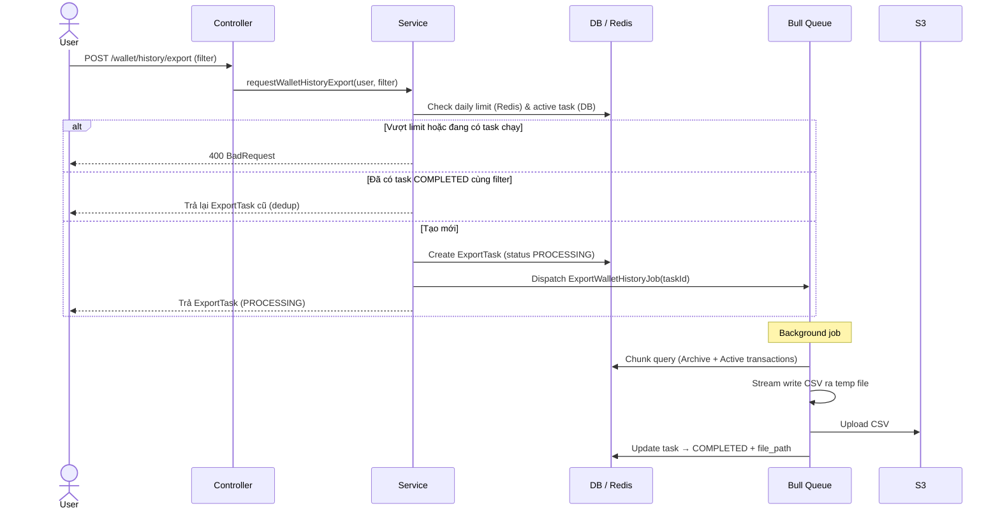
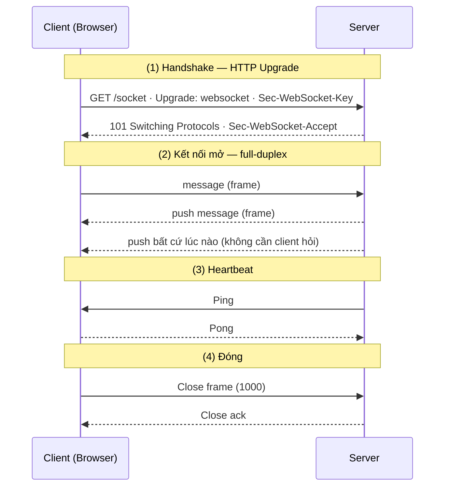
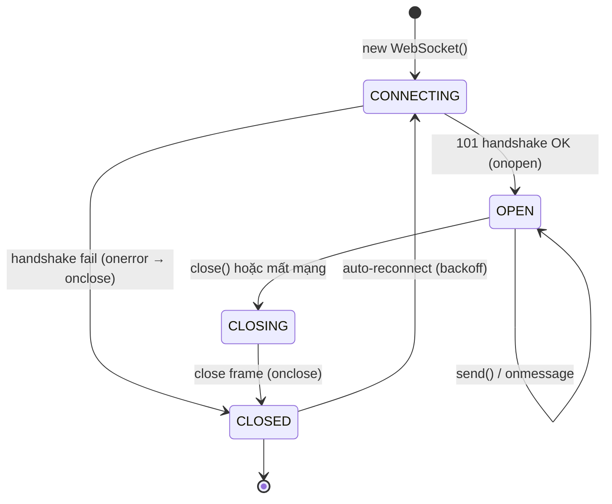
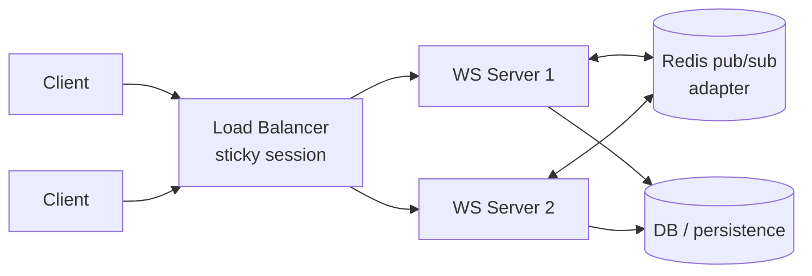

<a id="mục-lục"></a>
# Common — HTTP / REST / API

> HTTP method · REST/GraphQL · Session/Cookie/Cache · giao tiếp client–server.
> (Các mảng khác đã tách riêng: [Bảo mật](./security.md) · [OOP](./oop.md) ·
> [SOLID & Design Pattern](./solid-design-pattern.md) · [Testing](./testing.md).)

## 📑 Mục lục

- [1. Toàn bộ các method trong RESTful API](#q1)
- [2. So sánh phương thức GET và POST](#q2)
  - [2.1. Có thể dùng POST cho API lấy dữ liệu, và GET cho API tạo mới dữ liệu không?](#q2-1)
  - [2.2. Tại sao Webhook lại dùng phương thức POST thay vì GET?](#q2-2)
- [3. HTTP status code là gì? Có mấy nhóm?](#q3)
- [4. Phân biệt Session, Cookie và Cache](#q4)
  - [4.1. Giải thích các thuộc tính bảo mật của Cookie (HttpOnly, Secure, SameSite, Expires/Max-Age)](#q4-1)
  - [4.2. Vòng đời của Session và Cookie](#q4-2)
- [5. Sự khác nhau giữa REST và GraphQL là gì?](#q5)
  - [5.1. GraphQL có thể dùng để mutate dữ liệu (thêm/sửa/xóa) được không?](#q5-1)
  - [5.2. GraphQL có hỗ trợ upload file hay không?](#q5-2)
- [6. Cách export file với số lượng lớn (1 triệu record)](#q6)
- [7. Cách import file với số lượng lớn (1 triệu record)](#q7)
  - [7.1. Cách xử lý timeout khi import file lớn](#q7-1)
- [8. Phân biệt CSV và XLSX khi xử lý dữ liệu lớn](#q8)
- [9. Các nguyên nhân trang web bị chậm? Cách chẩn đoán & khắc phục](#q9)
  - [9.1. Cách tăng tốc độ web (các kỹ thuật tối ưu)](#q9-1)
- [10. PWA (Progressive Web App) là gì?](#q10)
  - [10.1. Web App Manifest gồm những gì?](#q10-1)
- [11. Service Worker là gì?](#q11)
- [12. Trình bày về WebSocket](#q12)
  - [12.1. Các thành phần của WebSocket](#q12-1)
  - [12.2. Cách thức hoạt động (handshake → trao đổi → đóng)](#q12-2)
  - [12.3. Vòng đời của một kết nối](#q12-3)
  - [12.4. WebSocket khác Polling và Server-Sent Events (SSE)](#q12-4)
  - [12.5. Heartbeat: Ping và Pong](#q12-5)
  - [12.6. Tự động kết nối lại (auto-reconnect)](#q12-6)
  - [12.7. Xác thực (Authentication) WebSocket](#q12-7)
  - [12.8. Authorization — kiểm tra quyền từng hành động](#q12-8)
  - [12.9. Những vấn đề khi scale WebSocket](#q12-9)
  - [12.10. Sticky session](#q12-10)
  - [12.11. Backpressure](#q12-11)
  - [12.12. Message delivery không đảm bảo tuyệt đối](#q12-12)
  - [12.13. WebSocket phù hợp khi nào — ưu/nhược & kiến trúc](#q12-13)
  - [12.14. Phân biệt WebSocket với HTTP](#q12-14)
  - [12.15. Ví dụ đơn giản: chat online](#q12-15)

---

<a id="q1"></a>
## 1. Toàn bộ các method trong RESTful API

### 📖 Giới thiệu kiến thức

REST mô hình hóa dữ liệu thành **resource** (mỗi resource có URL), và dùng **HTTP method** (còn gọi
*verb*) để biểu đạt *hành động* lên resource đó. Cùng một URL `/users/1`, đổi method là đổi ý nghĩa
thao tác. Các method ánh xạ khá sát với **CRUD** (Create – Read – Update – Delete).

**5 method CRUD chính:**

- **GET** — **đọc/lấy** resource. *Safe* (không đổi state), *idempotent*, *cacheable*. Không có body.
- **POST** — **tạo mới** resource (hoặc kích hoạt xử lý nghiệp vụ). *Không* safe, *không* idempotent.
- **PUT** — **thay thế TOÀN BỘ** resource tại một URI xác định (full replace). *Idempotent* (gửi lại
  cùng payload → cùng kết quả).
- **PATCH** — **cập nhật MỘT PHẦN** resource (partial update). Thường *không* idempotent (tùy thiết kế,
  vd `+1` vào counter thì gọi 2 lần ra 2 kết quả khác nhau).
- **DELETE** — **xóa** resource. *Idempotent* (xóa rồi xóa lại vẫn là "không còn").

**Method bổ trợ (hay bị hỏi thêm):**

- **HEAD** — giống GET nhưng server **chỉ trả header, không trả body**. Dùng để kiểm tra resource
  **tồn tại không**, lấy `Content-Length`, `Last-Modified`... mà không tải nội dung. Safe, idempotent.
- **OPTIONS** — hỏi server resource này **cho phép những method nào** (trả về header `Allow`); đặc biệt
  dùng trong **CORS preflight** của trình duyệt. Safe, idempotent.
- **TRACE / CONNECT** — ít dùng trong REST: TRACE để debug (echo lại request), CONNECT để mở tunnel
  qua proxy (vd HTTPS). Thường bị **tắt** vì lý do bảo mật.

**3 thuộc tính phải nắm:**

- **Safe** — không làm thay đổi state server: **GET, HEAD, OPTIONS**.
- **Idempotent** — gọi N lần cho hiệu ứng như gọi 1 lần: **GET, PUT, DELETE, HEAD, OPTIONS**.
  **POST** và (thường) **PATCH** thì **không**.
- **Cacheable** — response có thể cache: chủ yếu **GET, HEAD**.

| Method | Mục đích (CRUD) | Safe | Idempotent | Cacheable | Body request |
|--------|-----------------|------|------------|-----------|--------------|
| GET | Read (đọc) | ✅ | ✅ | ✅ | ❌ |
| POST | Create / xử lý | ❌ | ❌ | ❌ (mặc định) | ✅ |
| PUT | Update — thay **toàn bộ** | ❌ | ✅ | ❌ | ✅ |
| PATCH | Update — **một phần** | ❌ | ⚠️ thường không | ❌ | ✅ |
| DELETE | Delete (xóa) | ❌ | ✅ | ❌ | tùy |
| HEAD | Read (chỉ header) | ✅ | ✅ | ✅ | ❌ |
| OPTIONS | Metadata / CORS preflight | ✅ | ✅ | ❌ | ❌ |

```http
GET     /api/users        # lấy danh sách user
GET     /api/users/1      # lấy user id=1
POST    /api/users        # tạo user mới (dữ liệu trong body)
PUT     /api/users/1      # thay TOÀN BỘ user 1 (gửi đủ mọi field)
PATCH   /api/users/1      # sửa MỘT PHẦN user 1 (vd chỉ đổi email)
DELETE  /api/users/1      # xóa user 1
HEAD    /api/users/1      # kiểm tra tồn tại / lấy header, không tải body
OPTIONS /api/users        # hỏi method được phép (dùng cho CORS preflight)
```

> **PUT vs PATCH** là cặp hay bị hỏi sâu: **PUT** gửi *toàn bộ* representation và thay thế → idempotent;
> **PATCH** chỉ gửi *phần thay đổi* → linh hoạt hơn nhưng có thể không idempotent.

### 🎯 Tóm tắt trả lời phỏng vấn

- **5 method CRUD chính:** **GET** (đọc), **POST** (tạo), **PUT** (thay toàn bộ), **PATCH** (sửa một
  phần), **DELETE** (xóa).
- **2 method bổ trợ hay hỏi:** **HEAD** (như GET nhưng chỉ trả header), **OPTIONS** (hỏi method được
  phép / dùng cho **CORS preflight**). Còn TRACE/CONNECT hiếm dùng, thường bị tắt.
- **Thuộc tính phải nhớ:** *Safe* = GET/HEAD/OPTIONS (không đổi state); *Idempotent* = GET/PUT/DELETE/
  HEAD/OPTIONS (POST & thường PATCH thì **không**); *Cacheable* chủ yếu GET/HEAD.
- **PUT vs PATCH:** PUT thay **toàn bộ** resource (idempotent), PATCH sửa **một phần** (có thể không
  idempotent).
- **Câu chốt:** chọn method theo **ngữ nghĩa hành động lên resource** — cùng URL, đổi method là đổi ý nghĩa.

[↑ Mục lục](#mục-lục)

<a id="q2"></a>
## 2. So sánh phương thức GET và POST

### 📖 Giới thiệu kiến thức

**GET** và **POST** là hai HTTP method phổ biến nhất, dùng để client gửi yêu cầu tới server. Chúng
khác nhau cả về **mục đích ngữ nghĩa (semantics)** lẫn **cách truyền dữ liệu**.

- **GET** — dùng để **lấy (đọc) dữ liệu**. Tham số đi kèm trong **query string trên URL**
  (`/users?page=2&sort=name`). GET là phương thức **safe** (không làm thay đổi state server) và
  **idempotent** (gọi nhiều lần cho kết quả như gọi một lần).
- **POST** — dùng để **gửi dữ liệu lên server**, thường để **tạo mới** hoặc xử lý nghiệp vụ. Dữ liệu
  nằm trong **request body** (form-data, JSON...). POST **không safe** và **không idempotent**
  (gọi 2 lần có thể tạo 2 bản ghi).

Bảng so sánh:

| Tiêu chí | GET | POST |
|----------|-----|------|
| Mục đích | Lấy / đọc dữ liệu | Gửi dữ liệu, tạo mới, xử lý |
| Vị trí dữ liệu | Query string trên URL | Request body |
| Safe (không đổi state) | ✅ Có | ❌ Không |
| Idempotent | ✅ Có | ❌ Không |
| Cache được | ✅ Có (mặc định) | ❌ Không (mặc định) |
| Bookmark / lưu lịch sử | ✅ Được | ❌ Không |
| Giới hạn độ dài | Có (URL ~2KB tùy trình duyệt/server) | Gần như không giới hạn |
| Hiển thị dữ liệu | Lộ trên URL, history, log | Nằm trong body (kín hơn, nhưng **không mã hóa**) |
| Dùng cho dữ liệu nhạy cảm | ❌ Tránh | ⚠️ Đỡ hơn, nhưng vẫn cần **HTTPS** |

> Lưu ý quan trọng: POST **không phải là "bảo mật"** hơn GET. Cả hai đều plaintext nếu không có
> **HTTPS**. POST chỉ *kín đáo hơn* vì dữ liệu không nằm chình ình trên URL/log.

### 🎯 Tóm tắt trả lời phỏng vấn

- **GET = đọc dữ liệu**, tham số trên **URL (query string)**, là **safe + idempotent**, **cache &
  bookmark được**, nhưng **giới hạn độ dài** và lộ dữ liệu trên URL.
- **POST = gửi/tạo dữ liệu**, tham số trong **body**, **không safe, không idempotent**, không cache
  mặc định, không giới hạn độ dài.
- Điểm hay bị hiểu sai: **POST không bảo mật hơn GET** — muốn an toàn phải dùng **HTTPS**. POST chỉ
  kín đáo hơn vì dữ liệu không nằm trên URL.
- Câu chốt: chọn method theo **ngữ nghĩa hành động** — đọc thì GET, thay đổi state thì POST.

[↑ Mục lục](#mục-lục)

<a id="q2-1"></a>
### 2.1. Có thể dùng POST cho API lấy dữ liệu, và GET cho API tạo mới dữ liệu không?

#### 📖 Giới thiệu kiến thức

**Về mặt kỹ thuật thì được** — HTTP không *ép buộc* server phải đối xử với mỗi method theo đúng
ngữ nghĩa. Nhưng làm vậy là **vi phạm semantics của HTTP/REST**, và mỗi chiều có hệ quả khác nhau.

**Dùng GET để tạo/sửa dữ liệu — gần như KHÔNG bao giờ nên.** Vì GET được mặc định coi là **safe**,
nên cả hệ sinh thái web đối xử với nó như thao tác "vô hại":
- Trình duyệt, proxy, CDN có thể **cache** lại response.
- Trình duyệt **prefetch** link, bot/crawler tự động **gọi GET** mọi URL chúng thấy.
- Khi lỗi mạng, client/proxy có thể **tự retry** GET.

→ Hậu quả: một URL kiểu `GET /users/delete?id=5` có thể bị **bot quét hoặc trình duyệt prefetch gọi
nhầm**, gây tạo/xóa dữ liệu ngoài ý muốn. Ngoài ra tham số tạo dữ liệu sẽ **lộ trên URL, log,
history**. Đây là lỗi an toàn nghiêm trọng → **không dùng GET cho hành động thay đổi state**.

**Dùng POST để lấy dữ liệu — đôi khi chấp nhận được.** Nó *hoạt động bình thường*, chỉ là **mất các
lợi ích của GET**: không cache được, không bookmark được, mất tính idempotent về mặt quy ước. Tuy
vậy có những trường hợp thực tế người ta cố tình dùng POST để "đọc":
- **Query quá lớn/phức tạp** vượt giới hạn độ dài URL (vd: filter tìm kiếm nhiều điều kiện) →
  Elasticsearch `_search`, GraphQL đều gửi query trong **body bằng POST**.
- **Tham số nhạy cảm** không muốn lộ trên URL/log (dù vẫn phải có HTTPS).

```http
# ❌ SAI: dùng GET để tạo — bị cache/prefetch/bot gọi nhầm, lộ data trên URL
GET /api/users?name=Cuom&role=admin   → tạo user

# ✅ ĐÚNG: tạo mới dùng POST, dữ liệu trong body
POST /api/users
Content-Type: application/json
{ "name": "Cuom", "role": "admin" }

# ⚠️ CHẤP NHẬN ĐƯỢC: POST để "đọc" khi query quá lớn/nhạy cảm (mất cache/bookmark)
POST /api/users/search
{ "filters": { "age": [18, 35], "tags": ["a","b","c", ...] } }
```

#### 🎯 Tóm tắt trả lời phỏng vấn

- **Kỹ thuật thì làm được cả hai**, nhưng đó là **vi phạm semantics HTTP** và không nên tùy tiện.
- **GET cho tạo/sửa dữ liệu: gần như KHÔNG bao giờ.** GET bị coi là safe → bị **cache, prefetch,
  bot crawl, auto-retry** → dễ gọi nhầm gây thay đổi dữ liệu; lại còn **lộ tham số trên URL/log**.
- **POST để lấy dữ liệu: đôi khi chấp nhận được** (query quá lớn vượt giới hạn URL, hoặc tham số
  nhạy cảm) — ví dụ **GraphQL, Elasticsearch `_search`**. Cái giá là **mất cache & bookmark**.
- Câu chốt: **không dùng GET cho thao tác làm thay đổi state**; còn POST-để-đọc chỉ dùng khi có lý
  do chính đáng, không phải mặc định.

[↑ Mục lục](#mục-lục)

<a id="q2-2"></a>
### 2.2. Tại sao Webhook lại dùng phương thức POST thay vì GET?

#### 📖 Giới thiệu kiến thức

**Webhook** là cơ chế **server-to-server callback**: khi một sự kiện xảy ra ở hệ thống nguồn
(vd: thanh toán thành công, có commit mới, đơn hàng đổi trạng thái), hệ thống đó **chủ động gửi một
HTTP request** kèm dữ liệu sự kiện tới một URL mà bên nhận đã đăng ký trước. Khác với API thường
(client *hỏi* server — kiểu *pull*), webhook là **server đẩy dữ liệu** tới bên nhận (kiểu *push*).

Vì bản chất webhook là **"đẩy/gửi một gói dữ liệu sự kiện" và kích hoạt xử lý** ở bên nhận, nó khớp
hoàn toàn với ngữ nghĩa của **POST**, chứ không phải GET. Cụ thể vì sao POST hợp lý hơn:

1. **Có payload và thường lớn/phức tạp.** Sự kiện đi kèm dữ liệu (JSON: thông tin đơn hàng, user,
   chữ ký...). POST mang payload trong **body** không giới hạn độ dài; còn GET (theo ngữ nghĩa) **không
   có body** và URL bị giới hạn ~2KB → không thể chở payload phong phú.
2. **Là hành động làm thay đổi state, không idempotent.** Bên nhận sẽ *xử lý* sự kiện (tạo bản ghi,
   gửi mail, cập nhật trạng thái). Đó là thao tác **không safe** → đúng vai trò của POST, sai vai trò
   của GET (GET phải là *safe*).
3. **Tránh bị cache / prefetch / crawl.** GET bị hạ tầng web coi là an toàn nên có thể bị **cache,
   prefetch, bot gọi lại** — cực kỳ tai hại với một lần "giao sự kiện" (có thể xử lý trùng/mất kiểm
   soát). POST không bị cache mặc định.
4. **Kín đáo & bảo mật hơn.** Dữ liệu sự kiện nằm trong body, **không lộ trên URL/log**; đồng thời
   thường gửi kèm **header chữ ký HMAC** (vd `X-Signature`) để bên nhận xác minh request đúng từ nguồn
   hợp lệ. Việc này tự nhiên với POST + body.

```http
# Webhook: hệ thống nguồn ĐẨY sự kiện tới URL bên nhận đã đăng ký
POST /webhooks/payment-succeeded
Content-Type: application/json
X-Signature: sha256=9f86d08...        # HMAC để bên nhận xác minh nguồn

{ "event": "payment.succeeded", "order_id": 1024, "amount": 500000 }
```

> Ngoại lệ nhỏ: khi *đăng ký/xác thực* endpoint, một số nền tảng (vd Facebook, WhatsApp) gửi **GET**
> một lần để "verify" URL (echo lại `challenge`). Nhưng việc **giao sự kiện thật** thì luôn dùng POST.

#### 🎯 Tóm tắt trả lời phỏng vấn

- **Webhook = server đẩy (push) dữ liệu sự kiện** tới URL bên nhận khi có sự kiện → bản chất là
  "gửi data + kích hoạt xử lý" → khớp **POST**, không phải GET.
- **4 lý do dùng POST:** (1) chở **payload trong body** không giới hạn (GET không có body, URL ngắn);
  (2) là thao tác **thay đổi state, không idempotent** (GET phải *safe*); (3) tránh bị **cache/prefetch/
  bot gọi lại**; (4) **kín đáo hơn** + dễ kèm **chữ ký HMAC** để xác thực.
- Câu chốt: webhook là *push một sự kiện gây side-effect*, nên đúng ngữ nghĩa phải là POST; GET chỉ
  dùng cho bước verify endpoint lúc đăng ký.

[↑ Mục lục](#mục-lục)

<a id="q3"></a>
## 3. HTTP status code là gì? Có mấy nhóm?

### 📖 Giới thiệu kiến thức

**HTTP status code** là **số 3 chữ số** server trả về trong **response** để báo cho client **kết quả xử
lý request**. Nó nằm ở **status line** kèm một *reason phrase* mô tả (vd `200 OK`, `404 Not Found`). Chữ
**số đầu** quyết định **nhóm** ý nghĩa → nhìn chữ số đầu là biết đại ý.

#### 5 nhóm (theo chữ số đầu)

| Nhóm | Ý nghĩa | Ví dụ tiêu biểu |
|------|---------|-----------------|
| **1xx** Informational | Đã nhận request, đang tiếp tục | `100 Continue`, `101 Switching Protocols`, `103 Early Hints` |
| **2xx** Success | Xử lý **thành công** | `200 OK`, `201 Created`, `202 Accepted`, `204 No Content` |
| **3xx** Redirection | **Chuyển hướng**, cần thao tác thêm | `301 Moved Permanently`, `302 Found`, `304 Not Modified`, `308` |
| **4xx** Client Error | Lỗi do **phía client** (request sai) | `400`, `401`, `403`, `404`, `405`, `409`, `422`, `429` |
| **5xx** Server Error | Lỗi do **phía server** | `500`, `502`, `503`, `504` |

#### Các mã hay dùng trong REST API (phải nhớ)

**2xx — thành công**
- **200 OK** — thành công chung (GET/PUT/PATCH trả dữ liệu).
- **201 Created** — **tạo mới** thành công (POST); nên kèm header **`Location`** trỏ resource vừa tạo.
- **202 Accepted** — đã nhận, **xử lý bất đồng bộ** (job nền) chưa xong.
- **204 No Content** — thành công nhưng **không có body** (vd DELETE, hoặc PUT không trả data).

**3xx — chuyển hướng**
- **301** (vĩnh viễn) vs **302/307** (tạm thời): 301 được **cache** & đổi URL SEO; 302/307 chỉ tạm.
  **308/307** giữ nguyên method & body (301/302 có thể bị đổi POST→GET).
- **304 Not Modified** — dùng với cache điều kiện (`ETag`/`If-None-Match`): client dùng lại bản cache.

**4xx — lỗi client**
- **400 Bad Request** — request **sai cú pháp / không parse được** (JSON hỏng, thiếu tham số bắt buộc).
- **401 Unauthorized** — thực chất là **chưa xác thực** (chưa login / token sai-hết hạn).
- **403 Forbidden** — **đã xác thực nhưng không đủ quyền**.
- **404 Not Found** — không có resource; **405 Method Not Allowed** — sai method cho URL đó.
- **409 Conflict** — xung đột trạng thái (vd trùng unique, version mismatch).
- **422 Unprocessable Entity** — cú pháp đúng nhưng **fail validation nghiệp vụ** (email sai định dạng...).
- **429 Too Many Requests** — vượt **rate limit**.

**5xx — lỗi server**
- **500 Internal Server Error** — lỗi chung chưa bắt được (exception).
- **502 Bad Gateway** — proxy/gateway nhận response hỏng từ upstream.
- **503 Service Unavailable** — server quá tải / bảo trì (nên kèm `Retry-After`).
- **504 Gateway Timeout** — gateway **chờ upstream quá lâu**.

#### Các cặp hay bị hỏi / hay nhầm

- **401 vs 403:** 401 = *chưa biết bạn là ai* (authentication); 403 = *biết rồi nhưng không cho*
  (authorization). Chi tiết ở [security.md](./security.md).
- **400 vs 422:** 400 = request **hỏng/không parse được**; 422 = parse OK nhưng **sai validation**.
- **200 vs 201 vs 204:** đọc/cập nhật → 200; **tạo mới → 201 + `Location`**; không trả body → 204.
- **Anti-pattern:** trả **`200 OK` kèm body báo lỗi** → sai; phải dùng **đúng status code** để client/tool
  (retry, monitoring) xử lý đúng.

```http
POST /api/users            → 201 Created,  Location: /api/users/1001
GET  /api/users/999        → 404 Not Found
PUT  /api/users/1  (JSON hỏng)     → 400 Bad Request
POST /api/users  (email sai định dạng) → 422 Unprocessable Entity
DELETE /api/users/1        → 204 No Content
(gọi khi chưa đăng nhập)   → 401 Unauthorized
(user thường gọi API admin)→ 403 Forbidden
```

### 🎯 Tóm tắt trả lời phỏng vấn

- **Status code = số 3 chữ số** trong response báo kết quả; **chữ số đầu = nhóm**: **1xx** thông tin,
  **2xx** thành công, **3xx** chuyển hướng, **4xx** lỗi client, **5xx** lỗi server.
- **2xx:** 200 OK, **201 Created** (POST, kèm `Location`), 202 Accepted (async), **204 No Content** (DELETE).
- **4xx:** **400** (request hỏng) vs **422** (fail validation); **401** (chưa xác thực) vs **403** (không
  đủ quyền); 404 (không có), 405 (sai method), 409 (conflict), **429** (rate limit).
- **5xx:** 500 (lỗi chung), 502 (upstream hỏng), 503 (quá tải/bảo trì), 504 (upstream timeout).
- **Nhớ kỹ:** **401 ≠ 403**, **400 ≠ 422**, tạo mới trả **201 + Location**; **đừng trả 200 kèm lỗi** —
  dùng đúng mã để client/monitoring xử lý đúng.

[↑ Mục lục](#mục-lục)

<a id="q4"></a>
## 4. Phân biệt Session, Cookie và Cache

### 📖 Giới thiệu kiến thức

Ba khái niệm hay bị gộp chung nhưng phục vụ **2 mục đích khác hẳn nhau**: **Cookie & Session** dùng để
**quản lý trạng thái/danh tính người dùng** (vì HTTP vốn *stateless* — mỗi request độc lập, server
không tự nhớ bạn là ai); còn **Cache** dùng để **tăng tốc độ** bằng cách lưu sẵn bản sao dữ liệu.

**Cookie** — mẩu dữ liệu nhỏ (~4KB) **lưu ở phía client (trình duyệt)**. Server gửi xuống qua header
`Set-Cookie`, và sau đó trình duyệt **tự động đính kèm cookie** vào *mọi request* tới đúng domain qua
header `Cookie`. Dùng để lưu: session id, ngôn ngữ, theme, tracking... Có các thuộc tính bảo mật quan
trọng: `HttpOnly` (JS không đọc được → chống XSS đánh cắp), `Secure` (chỉ gửi qua HTTPS), `SameSite`
(chống CSRF), `Expires/Max-Age` (thời hạn).

**Session** — dữ liệu **lưu ở phía server**, đại diện cho một phiên làm việc của user (đã đăng nhập,
giỏ hàng...). Server cấp một **session id** và thường gửi id này xuống client **bằng cookie**; ở các
request sau, server đọc session id từ cookie để biết "đây là ai" và lấy lại dữ liệu phiên. Dữ liệu thật
nằm trên server (RAM, file, **Redis**, DB) nên **an toàn hơn cookie** với thông tin nhạy cảm.

**Cache** — lưu **bản sao** của dữ liệu/kết quả đã tính để lần sau lấy nhanh, **giảm tính toán lại và
round-trip**. Không nhằm nhận diện user. Có nhiều tầng: **browser cache**, **CDN**, **HTTP cache**
(`Cache-Control`, `ETag`), **server-side cache** (Redis/Memcached), query cache, OPcache (PHP).

```text
# Luồng đăng nhập điển hình — cookie "cõng" session id, dữ liệu thật ở server:
1. Client POST /login (user + pass)
2. Server tạo Session (lưu user_id ở Redis) → trả: Set-Cookie: SID=abc123; HttpOnly; Secure
3. Request sau: trình duyệt tự gửi  Cookie: SID=abc123
4. Server lấy SID → tra Redis → biết là user nào (không cần đăng nhập lại)
```

Bảng so sánh:

| Tiêu chí | Cookie | Session | Cache |
|----------|--------|---------|-------|
| Mục đích | Lưu state nhỏ phía client | Lưu state/phiên user phía server | Tăng tốc, giảm tải |
| Nơi lưu | **Client** (trình duyệt) | **Server** (RAM/Redis/DB) | Client, CDN, hoặc server |
| Dung lượng | Nhỏ (~4KB) | Lớn tùy server | Tùy hệ thống |
| Gửi kèm request | Tự động qua header `Cookie` | Không (chỉ gửi session id qua cookie) | Không |
| Bảo mật dữ liệu nhạy cảm | Kém (ở client) — cần `HttpOnly`/`Secure` | Tốt hơn (ở server) | Không dành cho danh tính |
| Vòng đời | Theo `Expires/Max-Age` | Theo timeout phiên | Theo TTL / chiến lược invalidate |
| Ai giữ dữ liệu | Người dùng | Hệ thống | Tầng cache |

**Quan hệ giữa chúng:** Cookie thường là *phương tiện* mang **session id** để liên kết client với
session trên server. Cache thì *vuông góc* (orthogonal) với hai cái kia — nó lo hiệu năng, không lo
danh tính. (Lưu ý: một số kiến trúc dùng **cache như Redis làm nơi lưu session** — khi đó Redis đóng
*cả hai vai*, nhưng về khái niệm vẫn là hai mục đích khác nhau.)

### 🎯 Tóm tắt trả lời phỏng vấn

- HTTP **stateless** nên cần cơ chế nhớ trạng thái: **Cookie** lưu data nhỏ **ở client**, trình duyệt
  **tự gửi kèm mọi request**; **Session** lưu data **ở server**, đại diện phiên user.
- **Cookie thường "cõng" session id**: client giữ id (trong cookie), server giữ dữ liệu thật → nhạy
  cảm thì để ở **session (server)** an toàn hơn để trần trong cookie.
- **Cache khác mục đích hoàn toàn**: lưu **bản sao** để **tăng tốc/giảm tải**, không dùng để nhận diện
  user. Có nhiều tầng: browser, CDN, HTTP cache (`Cache-Control`/`ETag`), Redis/Memcached.
- Cookie bảo mật nhờ `HttpOnly` (chống XSS), `Secure` (HTTPS), `SameSite` (chống CSRF).
- Câu chốt: **Cookie & Session = quản lý state/danh tính** (client vs server); **Cache = tối ưu hiệu năng**.

[↑ Mục lục](#mục-lục)

<a id="q4-1"></a>
### 4.1. Giải thích các thuộc tính bảo mật của Cookie (HttpOnly, Secure, SameSite, Expires/Max-Age)

#### 📖 Giới thiệu kiến thức

Vì cookie nằm ở **client** và **tự động được gửi kèm mọi request**, nó là mục tiêu của nhiều kiểu tấn
công (đánh cắp qua XSS, sniff trên đường truyền, lợi dụng qua CSRF). Các thuộc tính dưới đây đặt khi
server gửi header `Set-Cookie`, giúp siết lại các rủi ro đó.

**1. `HttpOnly` — chống JS đọc trộm cookie.**
Cookie có flag này thì **JavaScript phía client không đọc được** (`document.cookie` không thấy nó).
Mục đích: nếu site dính **XSS**, mã độc cũng **không lấy được cookie** — đặc biệt là session id.
→ Lưu ý: `HttpOnly` **không ngăn XSS xảy ra**, nó chỉ chặn việc *đánh cắp cookie* qua JS.

**2. `Secure` — chỉ gửi qua HTTPS.**
Cookie chỉ được trình duyệt gửi đi trên kết nối **HTTPS (đã mã hóa)**, không gửi qua HTTP thường.
→ Ngăn cookie bị **bắt gói (sniff)** trên đường truyền (man-in-the-middle).

**3. `SameSite` — chống CSRF.**
Quy định cookie có được gửi kèm trong **request cross-site** (từ domain khác) hay không:
- **`Strict`** — chỉ gửi khi request **cùng site**; click link từ trang ngoài vào cũng *không* gửi
  ở lần điều hướng đầu. An toàn nhất nhưng ảnh hưởng UX (vd vào lại trang đã login thấy như chưa login).
- **`Lax`** (mặc định của trình duyệt hiện đại) — gửi khi **điều hướng top-level bằng GET** (click link),
  *không* gửi với POST cross-site, iframe hay AJAX cross-site. Cân bằng giữa an toàn và tiện dụng.
- **`None`** — gửi trong **mọi** request cross-site, nhưng **bắt buộc kèm `Secure`**. Dùng khi cần
  cookie bên thứ ba (vd nhúng widget, SSO).

**4. `Expires` / `Max-Age` — thời hạn sống.**
- **Không có cả hai** → **session cookie**: mất khi đóng trình duyệt.
- **`Expires`** = mốc thời gian **tuyệt đối** (GMT). **`Max-Age`** = số **giây** kể từ lúc nhận.
  Nếu có cả hai, **`Max-Age` được ưu tiên**. Đặt `Max-Age=0` (hoặc `Expires` trong quá khứ) để **xóa** cookie.

> Thuộc tính khác hay gặp: `Domain`/`Path` (giới hạn phạm vi cookie được gửi), `Partitioned` (CHIPS —
> cô lập cookie bên thứ ba theo site, đã nhắc ở phần PHP 8.5).

```http
# Cookie session id nên có đủ HttpOnly + Secure + SameSite
Set-Cookie: SID=abc123; HttpOnly; Secure; SameSite=Lax; Max-Age=3600; Path=/
```

```php
// Tương đương trong PHP
setcookie('SID', 'abc123', [
    'max-age'  => 3600,
    'path'     => '/',
    'secure'   => true,
    'httponly' => true,
    'samesite' => 'Lax',
]);
```

#### 🎯 Tóm tắt trả lời phỏng vấn

- **`HttpOnly`** — JS không đọc được cookie → chống **XSS đánh cắp** session (nhưng *không* ngăn XSS xảy ra).
- **`Secure`** — chỉ gửi qua **HTTPS** → chống **sniff** trên đường truyền.
- **`SameSite`** — chống **CSRF**: `Strict` (chặt nhất), `Lax` (mặc định, cân bằng), `None` (cho cross-site
  nhưng **bắt buộc `Secure`**).
- **`Expires`/`Max-Age`** — thời hạn: không set → **session cookie** (mất khi đóng browser); `Max-Age`
  (giây) ưu tiên hơn `Expires` (mốc tuyệt đối); `Max-Age=0` để xóa.
- **Best practice:** cookie chứa session id nên bật **`HttpOnly` + `Secure` + `SameSite=Lax/Strict`**.

[↑ Mục lục](#mục-lục)

<a id="q4-2"></a>
### 4.2. Vòng đời của Session và Cookie

#### 📖 Giới thiệu kiến thức

Hai thứ có vòng đời **riêng biệt** nhưng **liên kết qua session id**. Hiểu rõ giúp giải thích các tình
huống như "tại sao tự nhiên bị đăng xuất" hay "remember me" hoạt động thế nào.

**Vòng đời Cookie (phía client):**
1. **Tạo** — server trả header `Set-Cookie` trong response (hoặc JS đặt qua `document.cookie`).
2. **Lưu** — trình duyệt lưu cookie theo `Domain`/`Path`.
3. **Gửi** — ở *mọi* request khớp domain/path, trình duyệt **tự đính** header `Cookie`.
4. **Hết hạn / xóa** — khi quá `Expires`/`Max-Age`, hoặc đóng trình duyệt (nếu là session cookie),
   hoặc server gửi `Set-Cookie` với `Max-Age=0`, hoặc người dùng tự xóa.

**Vòng đời Session (phía server):**
1. **Tạo** — lần đầu cần lưu state (vd đăng nhập), server tạo bản ghi session + **session id**, rồi
   gửi id xuống client (thường qua cookie `Set-Cookie: SID=...`).
2. **Duy trì** — mỗi request client gửi lại session id → server **tra store** (RAM/Redis/DB) để lấy
   dữ liệu phiên và biết "đây là ai".
3. **Gia hạn / timeout** — session thường có **idle timeout** (vd 30 phút không hoạt động → hết hạn).
   Có thể **sliding** (mỗi lần truy cập reset đồng hồ) hoặc **absolute** (hết hạn cứng sau X giờ).
4. **Kết thúc** — khi **logout** (server hủy session + xóa cookie), hết timeout, server restart (nếu
   lưu RAM), hoặc bị **garbage collector** dọn (vd `session.gc` của PHP).

```text
# Quan hệ vòng đời:
Cookie còn  + Session còn   → đăng nhập bình thường
Cookie mất  (đóng browser)  → mất "vé" SID → coi như đăng xuất (dù session server có thể còn)
Session hết (timeout/gc)    → server không tìm thấy SID → tạo phiên mới → phải login lại
```

> **"Remember me"** chính là cách xử lý khi session hết hạn: ngoài session cookie ngắn hạn, hệ thống đặt
> thêm một **persistent cookie** (`Max-Age` dài, chứa token riêng) để **tự đăng nhập lại** và tạo session
> mới khi phiên cũ đã hết.

#### 🎯 Tóm tắt trả lời phỏng vấn

- **Cookie:** server `Set-Cookie` → browser lưu → **tự gửi kèm mọi request** → hết hạn theo `Expires`/
  `Max-Age` (không set = mất khi đóng browser) hoặc bị xóa (`Max-Age=0`).
- **Session:** tạo khi cần lưu state (login) → server giữ **dữ liệu** + cấp **session id** (gửi qua cookie)
  → mỗi request tra store bằng id → kết thúc khi **logout / idle timeout / server dọn (gc)**.
- **Quan hệ:** cookie là "**vé**" mang session id. **Mất cookie = mất phiên** (như đăng xuất); **session
  hết hạn ở server** thì vé trở nên vô nghĩa → tạo phiên mới.
- **"Remember me"** = đặt thêm **persistent cookie** chứa token để tự login lại khi session ngắn hạn đã hết.

[↑ Mục lục](#mục-lục)

<a id="q5"></a>
## 5. Sự khác nhau giữa REST và GraphQL là gì?

### 📖 Giới thiệu kiến thức

Cả hai đều là **cách thiết kế API** cho client lấy/ghi dữ liệu qua HTTP, nhưng triết lý khác nhau.

**REST (Representational State Transfer)** là một **kiến trúc** (architectural style): dữ liệu được
mô hình hóa thành **resource**, mỗi resource có **URL (endpoint) riêng**, thao tác bằng **HTTP method**
(`GET` đọc, `POST` tạo, `PUT/PATCH` sửa, `DELETE` xóa). Server trả về **cấu trúc cố định** (thường JSON).
- Ví dụ: `GET /users/1`, `GET /users/1/posts`.
- Nhược điểm điển hình:
  - **Over-fetching** — endpoint trả *dư* field so với nhu cầu (chỉ cần tên nhưng nhận cả object).
  - **Under-fetching** — một endpoint *không đủ*, phải gọi nhiều request cho dữ liệu liên quan
    (lấy user rồi lại gọi lấy posts, comments... → nhiều round-trip, dễ thành **N+1 request**).

**GraphQL** là một **query language cho API** (Facebook, 2015): thường chỉ có **một endpoint duy nhất**
(`POST /graphql`). Client **mô tả chính xác** dữ liệu và field mình cần; server trả **đúng từng đó**.
- Có **schema định kiểu mạnh (strongly typed)** + introspection (client tự khám phá API).
- **Một request** lấy được nhiều resource lồng nhau → giải quyết over/under-fetching.
- Nhược điểm: **cache khó hơn** (một endpoint, dùng POST nên mất HTTP caching tự nhiên của GET);
  phức tạp hơn; dễ **N+1 ở tầng resolver**; cần kiểm soát **độ sâu/độ phức tạp query** (tránh query
  bom tài nguyên); upload file & rate limiting kém tự nhiên hơn REST.

```graphql
# GraphQL: 1 request lấy đúng các field cần, gồm cả quan hệ lồng nhau
query {
  user(id: 1) {
    name
    posts(last: 3) { title }   # tránh under-fetching: không phải gọi thêm /users/1/posts
  }
}
```

Bảng so sánh:

| Tiêu chí | REST | GraphQL |
|----------|------|---------|
| Bản chất | Kiến trúc (architectural style) | Query language + runtime |
| Endpoint | Nhiều, mỗi resource một URL | Thường **1** endpoint (`/graphql`) |
| Lấy dữ liệu | Server quyết định cấu trúc trả về | **Client chọn đúng field cần** |
| Over/Under-fetching | Hay gặp | Hạn chế tối đa |
| Quan hệ lồng nhau | Thường nhiều request | 1 request lồng nhau |
| HTTP method | Dùng đủ GET/POST/PUT/DELETE | Hầu hết qua **POST** (có thể GET cho query) |
| Caching | **Dễ** (HTTP cache trên GET) | **Khó hơn** (cần cache ở tầng app/field) |
| Định kiểu (typing) | Không bắt buộc | **Schema strongly typed** |
| Versioning | Thường qua `/v1`, `/v2` | Tiến hóa schema (deprecate field) |
| Độ phức tạp | Đơn giản, phổ biến | Học & vận hành phức tạp hơn |

**Chọn cái nào?**
- **REST** hợp khi API tương đối ổn định, cần **cache mạnh** (CDN/HTTP cache), resource rõ ràng, đội
  ngũ muốn đơn giản — vd CRUD, public API.
- **GraphQL** tỏa sáng khi client **đa dạng** (mobile/web cần dữ liệu khác nhau), nhiều **quan hệ lồng
  nhau**, muốn giảm số request và tránh over/under-fetching — vd app có UI phức tạp, BFF.

### 🎯 Tóm tắt trả lời phỏng vấn

- **REST = kiến trúc** dựa trên *resource + nhiều endpoint + HTTP method*, server quyết định cấu trúc
  trả về. **GraphQL = query language**, thường *1 endpoint*, **client chọn đúng field cần**.
- GraphQL sinh ra để chữa 2 đau của REST: **over-fetching** (trả dư) và **under-fetching** (phải gọi
  nhiều request, dễ N+1) — bằng cách cho lấy **đúng dữ liệu + quan hệ lồng nhau trong 1 request**.
- Đánh đổi: **REST cache dễ** (HTTP cache trên GET), đơn giản, phổ biến; **GraphQL cache khó hơn**
  (1 endpoint/POST), phức tạp hơn, cần chặn query quá sâu, nhưng **linh hoạt** và có **schema định kiểu mạnh**.
- Chốt chọn: API ổn định + cần cache mạnh → **REST**; client đa dạng + dữ liệu lồng nhau phức tạp → **GraphQL**.

[↑ Mục lục](#mục-lục)

<a id="q5-1"></a>
### 5.1. GraphQL có thể dùng để mutate dữ liệu (thêm/sửa/xóa) được không?

#### 📖 Giới thiệu kiến thức

**Có — và đó là một phần cốt lõi của GraphQL, không phải tính năng phụ.** GraphQL có **3 loại
operation gốc (root operation type)**:

- **`query`** — **đọc** dữ liệu (tương đương `GET` bên REST).
- **`mutation`** — **ghi** dữ liệu: thêm/sửa/xóa (tương đương `POST/PUT/PATCH/DELETE` bên REST).
- **`subscription`** — nhận dữ liệu **real-time** khi có sự kiện (qua WebSocket).

Vậy việc thêm/sửa/xóa trong GraphQL được thực hiện bằng **`mutation`**. Vài điểm cần nhớ:

1. **Mutation vẫn trả về dữ liệu.** Khác REST (nhiều khi `DELETE` chỉ trả status code), mutation cho
   phép **chọn field muốn nhận lại ngay trong cùng request** — vd tạo user xong trả luôn `id` và
   `createdAt`, khỏi gọi thêm một query nữa.
2. **Các field trong mutation chạy TUẦN TỰ (serial).** Đây là khác biệt quan trọng với `query`: các
   field cấp cao nhất của *query* được phép resolve **song song**, nhưng của *mutation* thì chạy
   **lần lượt từ trên xuống** — để tránh hai thao tác ghi đè/đua nhau (race condition).
3. **Vẫn đi qua một endpoint `POST /graphql`.** Cả query lẫn mutation thường dùng chung 1 endpoint và
   gửi bằng **POST**; "loại" thao tác được phân biệt bằng **từ khóa trong câu lệnh**, không phải bằng
   HTTP method hay URL như REST.

```graphql
# Thêm mới: mutation + chọn field trả về ngay
mutation CreateUser {
  createUser(input: { name: "Cuom", role: "admin" }) {
    id            # nhận lại id vừa tạo trong cùng request
    createdAt
  }
}

# Sửa
mutation UpdateUser {
  updateUser(id: 1, input: { role: "editor" }) { id role }
}

# Xóa
mutation DeleteUser {
  deleteUser(id: 1) { success }
}
```

> **Lưu ý semantics:** giống chuyện "GET để tạo dữ liệu" bên REST — về mặt kỹ thuật bạn *có thể* viết
> resolver của một `query` để ghi dữ liệu, nhưng đó là **anti-pattern**. Quy ước GraphQL: **mọi thao
> tác làm thay đổi state phải nằm trong `mutation`**, để client/cache/tooling đối xử đúng (query mặc
> định được coi là an toàn để cache/gọi lại).

#### 🎯 Tóm tắt trả lời phỏng vấn

- **Có.** GraphQL có 3 root operation: **`query`** (đọc), **`mutation`** (thêm/sửa/xóa), **`subscription`**
  (real-time). Thêm/sửa/xóa dùng **`mutation`**.
- **Ưu điểm so với REST:** mutation **trả về luôn field mình cần** trong cùng request (tạo xong lấy
  ngay `id`...), không phải gọi thêm query.
- **Khác biệt kỹ thuật:** field cấp cao nhất của **query chạy song song**, còn **mutation chạy tuần tự**
  (tránh race condition khi ghi). Tất cả vẫn qua **1 endpoint `POST /graphql`**, phân biệt bằng từ khóa.
- **Câu chốt:** đừng để thao tác ghi trong `query` — quy ước là **mọi thay đổi state → `mutation`**
  (giống "không dùng GET để ghi" bên REST).

[↑ Mục lục](#mục-lục)

<a id="q5-2"></a>
### 5.2. GraphQL có hỗ trợ upload file hay không?

#### 📖 Giới thiệu kiến thức

**Bản thân spec GraphQL KHÔNG định nghĩa kiểu file/binary.** Hệ kiểu của GraphQL chỉ có các scalar
cơ bản (`Int`, `Float`, `String`, `Boolean`, `ID`) + kiểu do ta tự định nghĩa; **không có scalar
`File`/`Upload` chính thức**, và một câu lệnh GraphQL về bản chất là **JSON** — vốn không chở được
dữ liệu nhị phân thô. Vì vậy "upload file qua GraphQL" **phải dựa vào giải pháp bên ngoài spec**.

Có **3 cách phổ biến**, từ nên dùng → ít nên dùng:

**1. `multipart/form-data` + GraphQL multipart request spec (phổ biến nhất).**
Thay vì gửi `POST /graphql` dạng JSON thuần, client gửi request **`multipart/form-data`** (giống
form upload của REST) gồm: phần `operations` (câu mutation, chỗ nhận file để `null`), phần `map`
(ánh xạ file vào biến nào), và các **part nhị phân** của file. Server (Apollo Server, graphql-yoga...)
dùng một scalar **`Upload`** để nhận. Đây là chuẩn **de-facto** ([jaydenseric/graphql-multipart-request-spec](https://github.com/jaydenseric/graphql-multipart-request-spec)).

```graphql
# Schema: khai báo scalar Upload và mutation nhận file
scalar Upload

type Mutation {
  uploadAvatar(file: Upload!): String   # trả về URL ảnh sau khi lưu
}
```

```graphql
# Phía client: file được truyền qua biến $file (gửi kèm trong multipart)
mutation UploadAvatar($file: Upload!) {
  uploadAvatar(file: $file)
}
```

**2. Upload riêng qua REST, GraphQL chỉ giữ tham chiếu.** Client `POST` file lên một **endpoint REST
chuyên dụng** (hoặc thẳng lên S3), nhận về **URL/ID**, rồi truyền **chuỗi URL/ID đó** vào mutation
GraphQL như một `String` bình thường. Tách biệt rõ ràng, tận dụng hạ tầng upload sẵn có, dễ scale.

**3. Base64-encode file rồi nhét vào `String`.** Mã hóa file thành chuỗi Base64 và gửi như biến
`String` trong mutation. **Chỉ hợp file rất nhỏ**: Base64 **phình ~33% dung lượng**, tốn RAM/parsing,
dễ vượt giới hạn payload → **không khuyến nghị cho file lớn**.

**Cách hiện đại được ưa chuộng (đặc biệt khi scale):** dùng **pre-signed URL** — client hỏi server
một URL upload tạm thời (qua mutation), rồi **upload thẳng file lên S3/GCS**, sau đó báo lại key cho
server. File **không đi xuyên qua GraphQL server** → giảm tải, tránh giới hạn payload.

> **Tải file XUỐNG (download)** thì không có vấn đề gì: GraphQL chỉ cần trả về **URL** của file, client
> tự tải qua HTTP như bình thường. Khó khăn chỉ nằm ở chiều **upload** (binary đi lên).

#### 🎯 Tóm tắt trả lời phỏng vấn

- **Spec GraphQL không có sẵn kiểu file** (chỉ có scalar cơ bản, query là JSON nên không chở binary thô)
  → upload file **phải dùng giải pháp ngoài spec**, không "native" như REST.
- **3 cách:** (1) **`multipart/form-data`** theo *GraphQL multipart request spec* + scalar **`Upload`**
  (chuẩn de-facto, Apollo/Yoga hỗ trợ); (2) **upload qua REST/S3 riêng**, GraphQL chỉ truyền **URL/ID**;
  (3) **Base64** nhét vào `String` — chỉ cho file rất nhỏ (phình ~33%, không nên).
- **Khuyến nghị khi scale:** dùng **pre-signed URL** upload thẳng lên S3/GCS, file **không qua GraphQL
  server**.
- **Câu chốt:** GraphQL **upload được nhưng không tự nhiên** — thực tế hay tách upload sang REST/object
  storage; còn **download thì đơn giản** vì chỉ cần trả URL.

[↑ Mục lục](#mục-lục)

<a id="q6"></a>
## 6. Cách export file với số lượng lớn (1 triệu record)

### 📖 Giới thiệu kiến thức

**Vấn đề:** export 1 triệu record theo cách ngây thơ (load hết vào bộ nhớ rồi mới build file) sẽ gây
**tràn bộ nhớ (memory exhausted)** và **timeout HTTP**. Lời giải không phụ thuộc ngôn ngữ — đều xoay quanh
**4 nguyên tắc** dưới đây (kèm cách hiện thực ở Laravel & Node.js).

#### 1. KHÔNG load hết vào RAM — đọc dữ liệu theo lô / stream từ DB

Lấy dữ liệu **từng phần** thay vì một lần, để bộ nhớ luôn phẳng:

- **Laravel:** dùng **`cursor()`** (LazyCollection — stream từng dòng, 1 query) hoặc
  **`chunk()/chunkById()`** (lấy theo lô N dòng). Tránh `all()`/`get()` với tập lớn.
- **Node.js:** dùng **database streaming cursor** — vd `knex(...).stream()`, Sequelize/`pg` cursor,
  hoặc Mongoose `Model.find().cursor()` — đọc từng row mà không nạp toàn bộ.

#### 2. Ghi file theo dòng (streaming), không gom hết rồi mới ghi

Ghi **trực tiếp ra output/file theo từng dòng** → RAM không tăng theo số bản ghi. **CSV** nhẹ và nhanh hơn
nhiều so với **XLSX** cho dữ liệu lớn (XLSX phải dựng cấu trúc XML/zip, rất tốn bộ nhớ).

```php
// Laravel — stream CSV bằng fputcsv + cursor (RAM phẳng)
return response()->streamDownload(function () {
    $out = fopen('php://output', 'w');
    fputcsv($out, ['id', 'name', 'email']);              // header
    User::select('id', 'name', 'email')->cursor()->each(function ($u) use ($out) {
        fputcsv($out, [$u->id, $u->name, $u->email]);    // ghi từng dòng
    });
    fclose($out);
}, 'users.csv');
```

```js
// Node.js (Express) — pipe DB stream → CSV transform → response/file
const { stringify } = require('csv-stringify');
app.get('/export', (req, res) => {
  res.setHeader('Content-Type', 'text/csv');
  res.setHeader('Content-Disposition', 'attachment; filename="users.csv"');
  const dbStream = knex('users').select('id', 'name', 'email').stream(); // đọc theo dòng
  dbStream.pipe(stringify({ header: true })).pipe(res);                  // backpressure tự lo
});
```

> Mấu chốt Node.js là **Stream + pipe**: dữ liệu chảy qua từng chunk, cơ chế **backpressure** tự điều tiết
> tốc độ → không dồn hết vào RAM.

#### 3. Đẩy sang nền (background job) — KHÔNG export trực tiếp trong request

1 triệu record mất nhiều phút → không nên bắt user chờ trong một HTTP request (dễ timeout). Tạo **job chạy
nền** xuất file ra **Storage/S3**, xong thì **thông báo link download** (email/notification/websocket).

- **Laravel:** **queued job** (`ShouldQueue`); với **maatwebsite/excel** dùng `FromQuery` +
  `WithChunkReading` + `ShouldQueue` để tự chunk & chạy nền.
- **Node.js:** đẩy job vào **queue** (BullMQ/Bee-Queue + Redis) cho **worker** xử lý nền, rồi notify.

```php
// Laravel + maatwebsite/excel: export nền theo chunk
class UsersExport implements FromQuery, WithChunkReading, ShouldQueue {
    public function query() { return User::query(); }    // KHÔNG ->get()
    public function chunkSize(): int { return 1000; }
}
(new UsersExport)->queue('exports/users.xlsx');          // chạy nền
```

#### 4. Tối ưu thêm

- **Chỉ `SELECT` cột cần** (giảm dữ liệu & bộ nhớ), tránh eager-load thừa.
- **Tắt query log** trong vòng lặp lớn (Laravel: `DB::disableQueryLog()`/không bật Debugbar) để tránh phình RAM.
- Định dạng: ưu tiên **CSV** (tốc độ/bộ nhớ); chỉ dùng **XLSX** khi cần định dạng, và phải **chunk reading**.
- Cực lớn / định kỳ: cân nhắc **export ở tầng DB** (`SELECT ... INTO OUTFILE`) hoặc công cụ **ETL** chuyên dụng.

#### 5. Ví dụ flow thực tế (production-grade)

Flow dưới đây (export lịch sử ví, NestJS/Adonis + Bull Queue + Redis + S3) là một hiện thực **chuẩn** — đủ
4 nguyên tắc trên, **cộng thêm** các lớp bảo vệ thực tế:



**Vì sao tốt — các điểm vượt ngoài 4 nguyên tắc cơ bản:**
- **ExportTask + status tracking** (`PROCESSING → COMPLETED`, lưu `file_path`): trả response **ngay**
  (non-blocking), client **poll trạng thái** hoặc nhận link khi xong — đúng mô hình async (nguyên tắc 3).
- **Idempotency / dedup theo filter:** đã có task COMPLETED cùng filter → **trả lại luôn**, không export lại
  → tiết kiệm tài nguyên.
- **Rate limit (daily limit qua Redis) + chặn task đang chạy:** tránh **abuse** và **job trùng** cho cùng
  một user.
- **Queue (Bull) chạy nền** + **chunk query** (gồm cả dữ liệu **Archive** lẫn **Active**) + **stream CSV ra
  temp file** rồi **upload S3**: đúng nguyên tắc 1 & 2.

**Có thể cải thiện thêm (điểm cộng khi phỏng vấn):**
- **Thông báo khi xong** (email/websocket/push) thay vì chỉ để client poll.
- **Trả link tải bằng pre-signed URL** (S3) có hạn dùng, thay vì lộ `file_path` trực tiếp.
- **Xử lý thất bại:** thêm trạng thái `FAILED` + **retry** của Bull; **dọn temp file** sau khi upload.
- Đặt **TTL** cho file trên S3 (lifecycle policy) để tự xoá file export cũ.

### 🎯 Tóm tắt trả lời phỏng vấn

- **Đừng load hết vào RAM:** đọc theo lô/stream — Laravel **`cursor()`/`chunk()`**; Node.js **DB stream
  cursor** (`knex().stream()`, Mongoose `.cursor()`).
- **Ghi file theo dòng (streaming):** Laravel `fputcsv` + `response()->streamDownload()`; Node.js
  **Stream + pipe** (DB stream → csv-stringify → response, backpressure tự điều tiết). **CSV nhẹ/nhanh hơn
  XLSX** nhiều.
- **Đẩy sang nền (queue):** với 1 triệu record nên chạy **background job** xuất ra Storage/S3 rồi **thông báo
  link download**, tránh timeout request (Laravel queued job / maatwebsite/excel `FromQuery+WithChunkReading
  +ShouldQueue`; Node.js BullMQ + worker).
- **Tối ưu:** chỉ `SELECT` cột cần, tắt query log, ưu tiên **CSV**; cực lớn thì export ở **tầng DB/ETL**.
- **Pattern production:** tạo bản ghi **ExportTask** (status `PROCESSING→COMPLETED` + `file_path`) trả về
  ngay rồi xử lý nền; thêm **dedup theo filter** (đã có task cùng filter thì trả lại), **rate limit (Redis)**
  & chặn task trùng; xong thì **upload S3 + thông báo/pre-signed URL**, có trạng thái `FAILED`/retry.

[↑ Mục lục](#mục-lục)

<a id="q7"></a>
## 7. Cách import file với số lượng lớn (1 triệu record)

### 📖 Giới thiệu kiến thức

Import là chiều ngược của export (xem [câu 6](#q6)) và có **2 nút thắt**: **đọc file** (dễ tràn RAM) và
**ghi DB** (dễ chậm nếu insert sai cách). Lời giải chung (không phụ thuộc ngôn ngữ):

#### 1. Đọc file theo stream — KHÔNG load cả file vào RAM

Parse **từng dòng/chunk** thay vì đọc hết file:

- **Laravel:** `fopen` + vòng lặp **`fgetcsv`** (đọc từng dòng); hoặc **maatwebsite/excel** với
  **`WithChunkReading`** để đọc theo lô.
- **Node.js:** `fs.createReadStream().pipe(csv-parser)` xử lý từng row; với XLSX dùng **exceljs streaming
  reader**. (XLSX tốn RAM hơn CSV nhiều.)

#### 2. Ghi DB theo lô — BULK INSERT, tuyệt đối không insert từng dòng

1 triệu lệnh `INSERT` riêng lẻ = 1 triệu round-trip → **cực chậm**. Gom thành **bulk insert** mỗi lô
500–1000 dòng:

- **Laravel:** **`DB::table('users')->insert($chunk)`** (bulk) thay vì `Model::create()` từng dòng; cần
  upsert thì `upsert()`/`insertOrIgnore()`. Lưu ý: **Eloquent events/observer KHÔNG chạy** với bulk (xem
  `Backend/laravel.md`).
- **Node.js:** **`knex.batchInsert`**, `Model.bulkCreate` (Sequelize), `insertMany` (Mongo).

```php
// Laravel — đọc theo dòng + bulk insert mỗi 1000 record
$h = fopen($path, 'r');
fgetcsv($h);                                   // bỏ dòng header
$batch = [];
while (($row = fgetcsv($h)) !== false) {
    $batch[] = ['name' => $row[0], 'email' => $row[1], 'created_at' => now()];
    if (count($batch) === 1000) {
        DB::table('users')->insert($batch);    // bulk 1000
        $batch = [];
    }
}
if ($batch) DB::table('users')->insert($batch);
fclose($h);
```

```js
// Node.js — stream CSV + batchInsert, dùng pause/resume để giữ backpressure
const fs = require('fs'); const csv = require('csv-parser');
let batch = [];
const stream = fs.createReadStream('users.csv').pipe(csv());
stream.on('data', (row) => {
  batch.push(row);
  if (batch.length === 1000) {
    stream.pause();
    knex.batchInsert('users', batch, 1000).then(() => { batch = []; stream.resume(); });
  }
});
stream.on('end', async () => { if (batch.length) await knex.batchInsert('users', batch); });
```

```php
// maatwebsite/excel — đọc & insert theo lô, chạy nền
class UsersImport implements ToModel, WithChunkReading, WithBatchInserts, ShouldQueue {
    public function model(array $row) { return new User(['name' => $row[0], 'email' => $row[1]]); }
    public function chunkSize(): int { return 1000; }   // đọc theo lô
    public function batchSize(): int { return 1000; }   // insert theo lô
}
Excel::queueImport(new UsersImport, $request->file('file'));
```

#### 3. Chạy nền qua queue

Import 1 triệu dòng mất nhiều phút → **không** xử lý trong request (timeout). Upload file → lưu tạm
(S3/disk) → **dispatch job nền** xử lý → cập nhật tiến độ/kết quả. Giống pattern ImportTask (status
`PROCESSING→COMPLETED/FAILED`, số dòng đã xử lý, file báo lỗi).

#### 4. Validation & xử lý lỗi (quan trọng với import)

Khác export, import phải **kiểm tra dữ liệu bẩn**:
- Validate từng dòng; chọn chiến lược: **bỏ qua + ghi log dòng lỗi** (gom thành **error report** trả về)
  thay vì rollback cả triệu dòng vì 1 dòng sai.
- **Transaction theo lô** (per-chunk) để cân bằng an toàn & hiệu năng.
- **Idempotency:** dùng **`upsert`/unique key** để **retry không nhân đôi** dữ liệu.

#### 5. Tối ưu DB cho ghi lớn

- **Bulk insert + commit theo lô** (ít transaction).
- Tạm **tắt index/constraint check** rồi bật lại (MySQL `unique_checks=0`, `foreign_key_checks=0` — cẩn
  thận), hoặc tạo index **sau** khi nạp xong.
- **Tắt query log** (Laravel `DB::disableQueryLog()`), không giữ model trong RAM.
- Cực lớn: dùng **`LOAD DATA INFILE`** (MySQL) / **`COPY`** (PostgreSQL) — nhanh nhất, nạp thẳng từ file.

### 🎯 Tóm tắt trả lời phỏng vấn

- **Đọc file theo stream** (không load cả file): Laravel `fgetcsv` / `WithChunkReading`; Node.js
  `createReadStream().pipe(csv-parser)` / exceljs streaming.
- **Ghi DB bằng BULK INSERT theo lô** (500–1000), **không insert từng dòng**: Laravel
  `DB::table()->insert($chunk)`/`upsert`; Node.js `knex.batchInsert`/`bulkCreate`/`insertMany`. (Bulk **bỏ
  qua Eloquent events**.)
- **Chạy nền qua queue** (ImportTask: status, processed, error report), tránh timeout request.
- **Validation & lỗi:** validate từng dòng, **bỏ qua + log dòng lỗi** (error report) thay vì rollback cả
  triệu; **transaction theo lô**; **`upsert`/unique key** để retry không nhân đôi.
- **Tối ưu DB:** commit theo lô, tạm tắt index/constraint, tắt query log; cực lớn dùng **`LOAD DATA INFILE`
  / `COPY`**.

[↑ Mục lục](#mục-lục)

<a id="q7-1"></a>
### 7.1. Cách xử lý timeout khi import file lớn

#### 📖 Giới thiệu kiến thức

Import file lớn dễ vượt **nhiều loại timeout khác nhau** — phải nhận diện đúng loại rồi mới xử lý:

| Loại timeout | Ở đâu |
|--------------|-------|
| **HTTP / web server** (504) | Nginx `proxy_read_timeout`/`fastcgi_read_timeout`, PHP-FPM `request_terminate_timeout`, load balancer |
| **Runtime execution** | PHP `max_execution_time`; Node thường do framework/proxy |
| **Upload / body size** | Nginx `client_max_body_size`, PHP `upload_max_filesize`/`post_max_size` |
| **Queue worker** | Laravel queue `--timeout`/`retry_after`; Bull job timeout |
| **DB** | Transaction dài giữ lock → lock wait timeout |

**Giải pháp ĐÚNG — không xử lý đồng bộ trong request (loại bỏ HTTP timeout):**

- Request chỉ **nhận file → lưu (S3/disk) → tạo ImportTask → dispatch job nền → trả về ngay** (202 +
  task id). Worker xử lý nền; client **poll trạng thái** hoặc nhận **thông báo** khi xong. Vì việc nặng
  **không còn trong vòng đời HTTP request** nên **HTTP/web server timeout biến mất** (pattern ở
  [câu 7](#q7) nguyên tắc 3).
- **Upload file lớn:** cho client **upload thẳng lên S3 qua pre-signed URL**, job chỉ đọc từ S3 → tránh cả
  **upload timeout** lẫn **giới hạn body size**.

**Trong worker — tránh JOB timeout (vì 1 triệu dòng vẫn lâu):**

- **Chia nhỏ thành nhiều job** thay vì 1 job khổng lồ: mỗi job xử lý 1 chunk (vd 5–10k dòng) → mỗi job
  **ngắn**, chạy **song song**, dễ **retry phần lỗi** mà không fail toàn bộ. Laravel **`Bus::batch([...])`**
  (job batching); maatwebsite/excel **chunk reading** tự tạo job theo chunk.
- Cấu hình **timeout/retry hợp lý:** Laravel `--timeout` (đặt **`retry_after` > timeout** để tránh chạy
  trùng), `$tries`, `$backoff`; Bull `attempts`/`timeout`.
- **Resume & idempotency:** lưu **tiến độ** (offset/chunk đã xử lý) + dùng **`upsert`/unique key** → retry
  **không làm lại từ đầu**, **không nhân đôi** dữ liệu.

**DB:** **commit theo lô nhỏ**, tránh transaction quá dài giữ lock → tránh lock/timeout ở tầng DB.

**Nếu BUỘC xử lý đồng bộ (file vừa, không có queue) — chỉ là tạm:** tăng `set_time_limit(0)` (chạy CLI thì
không giới hạn), `max_execution_time`, timeout Nginx/PHP-FPM, body-size; nhưng file thật lớn vẫn rủi ro 504
→ **ưu tiên queue**.

#### 🎯 Tóm tắt trả lời phỏng vấn

- **Nhận diện loại timeout:** HTTP/web server (**504**), runtime (`max_execution_time`), **upload/body-size**,
  **queue worker timeout**, DB lock.
- **Giải pháp chính: đừng xử lý đồng bộ trong request** → đẩy sang **background job** (nhận file → tạo task
  → trả ngay → worker xử lý → poll/notify) ⇒ **HTTP timeout biến mất**. Upload lớn → **pre-signed URL lên S3**.
- **Tránh job timeout:** **chia nhỏ thành nhiều job theo chunk** (Laravel **`Bus::batch`**, maatwebsite
  chunk) thay vì 1 job khổng lồ → ngắn, song song, retry phần lỗi; cấu hình **`--timeout`/`retry_after`/
  `tries`**.
- **Resume/idempotency:** lưu tiến độ + **`upsert`/unique key** → retry không làm lại / nhân đôi.
- Buộc đồng bộ thì chỉ tạm: tăng `set_time_limit`/execution/Nginx-FPM/body-size; **DB commit theo lô** tránh
  lock lâu.

[↑ Mục lục](#mục-lục)

<a id="q8"></a>
## 8. Phân biệt CSV và XLSX khi xử lý dữ liệu lớn

### 📖 Giới thiệu kiến thức

Khi export/import dữ liệu lớn (xem [câu 6](#q6) & [câu 7](#q7)), việc chọn **CSV hay XLSX** ảnh hưởng lớn
tới bộ nhớ, tốc độ và cả tính đúng đắn của dữ liệu.

- **CSV (Comma-Separated Values):** **file text thuần** — mỗi dòng một record, các cột phân tách bằng dấu
  phẩy (hoặc delimiter khác). **Không** có định dạng, kiểu dữ liệu, công thức hay nhiều sheet.
- **XLSX:** định dạng Excel hiện đại — thực chất là **file ZIP chứa nhiều file XML** (Open XML). **Có** định
  dạng (màu/font/border), nhiều sheet, công thức, kiểu dữ liệu, biểu đồ.

| Tiêu chí | CSV | XLSX |
|----------|-----|------|
| Bản chất | Text thuần, từng dòng | **ZIP + XML** (cấu trúc phức tạp) |
| Bộ nhớ khi xử lý lớn | **Rất nhẹ** (stream từng dòng) | **Nặng** (parse/dựng XML, nén/giải nén) |
| Tốc độ | **Nhanh** | Chậm hơn nhiều (nhất là khi ghi) |
| Streaming | Tự nhiên (đọc/ghi từng dòng) | Khó — cần thư viện streaming chuyên (exceljs stream, chunk) |
| Giới hạn dòng | **Không giới hạn** | **~1.048.576 dòng/sheet** (giới hạn Excel) |
| Định dạng/kiểu/sheet | Không (mọi thứ là text) | Có (màu, công thức, kiểu số/ngày, nhiều sheet) |
| Kích thước file | Lớn hơn (text thô) | Nhỏ hơn nhờ nén ZIP (cùng dữ liệu) |
| Phù hợp | **ETL, import/export lớn, trao đổi máy–máy** | **Báo cáo cho người dùng** cần định dạng đẹp |

**Hệ quả với dữ liệu lớn:**
- **Mặc định chọn CSV:** nhẹ, nhanh, **stream dễ → RAM phẳng**, không giới hạn dòng → hợp 1 triệu+ record.
- **XLSX chỉ khi cần** định dạng/nhiều sheet/công thức cho end-user. Với 1 triệu record, XLSX **gần chạm
  trần ~1.048.576 dòng/sheet** và tốn RAM/CPU lớn → buộc phải **streaming + chunk**, hoặc **tách nhiều
  sheet/file**.

**Bẫy CSV (hay bị hỏi):**
- Khi user mở CSV bằng **Excel**, các giá trị bị **auto-format → mất/đổi dữ liệu**: mã có số 0 đầu (`007`),
  số điện thoại/CCCD, mã rất dài (đổi sang ký hiệu khoa học), chuỗi giống ngày.
- **Encoding:** tiếng Việt cần **UTF-8 có BOM** để Excel hiển thị đúng dấu.
- **Delimiter** thay đổi theo locale (`,` vs `;`); cần escape giá trị chứa dấu phẩy/xuống dòng bằng dấu nháy.

### 🎯 Tóm tắt trả lời phỏng vấn

- **CSV** = text thuần từng dòng → **nhẹ, nhanh, stream dễ (RAM phẳng), không giới hạn dòng** → **lựa chọn
  mặc định cho dữ liệu lớn / ETL / trao đổi máy–máy**.
- **XLSX** = **ZIP + XML**, có **định dạng/nhiều sheet/công thức/kiểu dữ liệu** nhưng **nặng RAM/CPU** và
  **giới hạn ~1.048.576 dòng/sheet** → 1 triệu record gần chạm trần; chỉ dùng khi cần **báo cáo đẹp cho
  người dùng**, và phải **streaming + chunk**.
- **Bẫy CSV:** Excel **auto-format** làm mất dữ liệu (số 0 đầu, mã dài, ngày), cần **UTF-8 BOM** cho tiếng
  Việt, để ý **delimiter** theo locale.
- **Chốt:** dữ liệu lớn → **CSV**; cần định dạng cho end-user → **XLSX** (chấp nhận chậm/nặng + giới hạn dòng).

[↑ Mục lục](#mục-lục)

<a id="q9"></a>
## 9. Các nguyên nhân trang web bị chậm? Cách chẩn đoán & khắc phục

### 📖 Giới thiệu kiến thức

Cách trả lời **ăn điểm** là đi **có hệ thống theo hành trình một request**, thay vì liệt kê lộn xộn.
Một trang chậm là do chậm ở **một (hoặc nhiều) chặng** trên đường đi:

```
[Browser] → DNS/TLS → [Network/CDN] → [Web server] → [Backend app] → [Database] → back → [Render]
```

#### 1) Frontend / trình duyệt (client-side)

- **Asset nặng:** ảnh chưa tối ưu (không nén, sai định dạng — nên WebP/AVIF, thiếu `srcset`), **JS/CSS
  bundle to**, không **minify**, không **tree-shaking/code-splitting**.
- **Render-blocking:** CSS/JS chặn render; không **defer/async** script; **không lazy-load** ảnh & phần
  dưới màn hình.
- **Main thread nghẽn:** JS thực thi nặng (long tasks), **reflow/repaint** liên tục, DOM quá lớn.
- **Không tận dụng cache trình duyệt** (thiếu `Cache-Control`/`ETag` — xem [câu 4](#q4)) → tải lại mọi
  lần.
- **Third-party scripts** (ads, analytics, chat) và **web font** tải chậm, chặn hiển thị.

#### 2) Network / truyền tải

- **Latency cao** do server **ở xa người dùng** + **không dùng CDN** (tải asset từ origin xa).
- **Không nén** response (thiếu **gzip/brotli**); payload **quá lớn**, không **pagination**.
- Còn dùng **HTTP/1.1** (head-of-line blocking) thay vì **HTTP/2/3** (multiplexing).
- Nhiều **round-trip** (request waterfall), **DNS lookup** chậm, **TLS handshake** tốn thời gian.

#### 3) Backend / server

- **Xử lý chậm:** thuật toán kém (vòng lặp lồng, O(n²)), **blocking I/O**, tính toán nặng ngay trong
  request thay vì **đẩy sang queue** (gửi mail, resize ảnh, export).
- **Thiếu caching** (Redis/Memcached) → **tính lại/gọi lại** mỗi request.
- **Gọi external API đồng bộ** & chậm; **cold start** (serverless).
- **Thiếu tài nguyên / không scale:** CPU/RAM cạn, một instance quá tải, **không load balancer**.

#### 4) Database (rất hay là thủ phạm chính)

- **Thiếu index** → **full table scan**; **N+1 query**; join/subquery nặng; **`SELECT *`** thừa cột.
- **Lock/contention**, **connection pool cạn**; dữ liệu lớn **không phân trang**, thiếu **read replica**.
- (Chi tiết tối ưu query/index xem `Backend/database-system.md`.)

#### 5) Hạ tầng & vận hành

- Cấu hình web server kém (ít worker), **không auto-scale/CDN**, **không monitoring** nên **không biết
  bottleneck** ở đâu.

#### Cách chẩn đoán (interviewer thích nghe)

- **Chia để trị bằng TTFB (Time To First Byte):** TTFB **cao** → nghẽn ở **backend/DB/network**; TTFB
  **thấp mà vẫn chậm** → vấn đề ở **frontend/rendering**.
- **Công cụ:** **Chrome DevTools** (Network waterfall, Performance), **Lighthouse / PageSpeed**, đo
  **Core Web Vitals** (**LCP, INP, CLS**); **APM** (New Relic, Datadog), **slow query log** cho DB.

#### Cách khắc phục (tổng quát)

**Caching nhiều tầng** (browser → CDN → server → DB) · **tối ưu asset** (minify, nén, WebP, lazy-load,
code-splitting) · **CDN** đưa nội dung gần user · **HTTP/2/3 + gzip/brotli** · **index DB + sửa N+1 +
phân trang** · **đẩy việc nặng sang queue** · **scale ngang + load balancer**.

### 🎯 Tóm tắt trả lời phỏng vấn

- **Trả lời theo hành trình request** (browser → network → server → DB → render), chậm ở chặng nào cũng
  làm trang chậm:
  - **Frontend:** asset nặng/không minify, ảnh chưa tối ưu, render-blocking JS/CSS, không lazy-load,
    không cache trình duyệt.
  - **Network:** không **CDN**, không **nén (gzip/brotli)**, payload lớn, còn HTTP/1.1, latency xa.
  - **Backend:** thiếu **cache (Redis)**, xử lý nặng đồng bộ (nên đẩy **queue**), external API chậm,
    thiếu tài nguyên/không scale.
  - **Database:** **thiếu index**, **N+1**, không phân trang, connection pool cạn (thủ phạm phổ biến nhất).
- **Chẩn đoán:** dùng **TTFB** để tách frontend vs backend; **DevTools/Lighthouse + Core Web Vitals
  (LCP/INP/CLS)**, **APM**, **slow query log**.
- **Khắc phục:** **cache nhiều tầng** + **tối ưu asset** + **CDN** + **HTTP/2 & nén** + **index/sửa
  N+1/phân trang** + **queue việc nặng** + **scale + load balancer**.

[↑ Mục lục](#mục-lục)

<a id="q9-1"></a>
### 9.1. Cách tăng tốc độ web (các kỹ thuật tối ưu)

#### 📖 Giới thiệu kiến thức

Đây là mặt còn lại của [câu 9](#q9): biết nguyên nhân rồi thì tối ưu ra sao. **Nguyên tắc vàng: ĐO
TRƯỚC, tối ưu SAU** — dùng profiler tìm đúng chỗ nghẽn (bottleneck) rồi mới sửa, tránh **premature
optimization**. Nhóm kỹ thuật theo từng tầng, ưu tiên theo **tác động**:

**1) Caching — đòn bẩy lớn nhất** (request nhanh nhất là request không phải thực hiện):
- **Browser cache:** `Cache-Control`/`ETag`, đặt asset **immutable** + **filename có hash** để cache lâu
  mà vẫn cập nhật được (xem [câu 4](#q4)).
- **CDN / edge cache:** cache static (và cả HTML) ở điểm gần user.
- **Server cache:** **Redis/Memcached** cho kết quả tính toán/query; **full-page / fragment cache**;
  reverse proxy (**Varnish/Nginx**).
- **Application/query cache:** nhớ kết quả các truy vấn/tính toán đắt.

**2) Tối ưu asset (frontend):**
- **Nén & minify:** bật **gzip/brotli**; minify HTML/CSS/JS.
- **Ảnh:** dùng **WebP/AVIF**, **responsive `srcset`**, nén, **lazy-load**, đúng kích thước hiển thị.
- **JS:** **code-splitting**, **tree-shaking**, **defer/async**, bỏ dead code → **giảm bundle**.
- **CSS:** **critical CSS** inline cho phần trên màn hình, bỏ CSS thừa.
- **Font:** `font-display: swap`, **preload**, **subset** font.
- **Giảm số request:** gộp file (hoặc dựa **HTTP/2 multiplexing**).

**3) Network / delivery:**
- **CDN** đưa nội dung gần user; **HTTP/2 / HTTP/3**; **brotli**.
- **Resource hints:** `preconnect`, `dns-prefetch`, `preload`, `prefetch`; giữ **keep-alive**.

**4) Chiến lược render:**
- Ưu tiên **SSR/SSG/ISR** thay vì CSR nặng → **first paint** nhanh + tốt SEO (xem `Frontend/vuejs.md`).
- **Lazy-load component**, **virtual scrolling** cho danh sách lớn, **skeleton/streaming** để cảm giác nhanh.

**5) Backend:**
- **Đẩy việc nặng sang queue/async** (mail, ảnh, export) để trả response nhanh.
- Tối ưu thuật toán, giảm **blocking I/O**; **gộp request** (chống chatty calls); **connection pooling**.

**6) Database:**
- **Index đúng**, **sửa N+1** (eager loading), tránh **`SELECT *`**, **phân trang** (cursor);
  **read replica**, **materialized view/denormalize** khi cần (chi tiết `Backend/database-system.md`).

**7) Hạ tầng & scale:**
- **Load balancer + scale ngang**, **auto-scaling**, đặt hạ tầng gần user; **monitoring/APM** để liên
  tục phát hiện điểm nghẽn (`Backend/devops.md`).

#### 🎯 Tóm tắt trả lời phỏng vấn

- **Nguyên tắc:** **đo trước (profile) rồi tối ưu chỗ nghẽn thật**, tránh premature optimization;
  **caching là đòn bẩy lớn nhất**.
- **Caching nhiều tầng:** browser (`Cache-Control`/`ETag` + asset hash) → **CDN/edge** → **server
  (Redis)** → DB/query cache.
- **Asset:** minify + **nén gzip/brotli**, ảnh **WebP/lazy-load/`srcset`**, **code-splitting/tree-shaking**,
  critical CSS, tối ưu font.
- **Delivery:** **CDN** + **HTTP/2/3** + resource hints (`preconnect`/`preload`).
- **Render:** **SSR/SSG** thay CSR nặng, lazy-load, virtual scroll.
- **Backend/DB:** **queue** việc nặng, **index + sửa N+1 + phân trang**, connection pool; **scale ngang
  + load balancer + monitoring**.

[↑ Mục lục](#mục-lục)

<a id="q10"></a>
## 10. PWA (Progressive Web App) là gì?

### 📖 Giới thiệu kiến thức

**PWA (Progressive Web App)** là **web app thông thường** (HTML/CSS/JS, chạy trên trình duyệt) nhưng
được bổ sung các công nghệ để mang lại **trải nghiệm gần như app native**: **cài được lên màn hình chính**,
**chạy offline**, **nhận push notification**, **tải nhanh** — mà **không cần qua App Store/Google Play**.
Chữ **"Progressive"** nghĩa là **nâng cấp tiệm tiến**: trình duyệt nào hỗ trợ thì có thêm tính năng, trình
duyệt cũ vẫn chạy được như web bình thường (**progressive enhancement**).

**3 trụ cột kỹ thuật (bắt buộc nắm):**
- **HTTPS** — bắt buộc chạy trên kết nối bảo mật (điều kiện để dùng Service Worker).
- **Service Worker** — script chạy nền làm **proxy mạng + cache** → cho **offline & tốc độ** (chi tiết
  [câu 11](#q11)).
- **Web App Manifest** (`manifest.json`) — file JSON khai báo **tên app, icon, `start_url`, `display`
  (standalone), màu theme** → để trình duyệt cho **"Cài đặt" (Add to Home Screen)** và mở như app riêng.

**Đặc điểm cốt lõi (theo Google — hay được hỏi):**
- **Reliable (tin cậy):** tải nhanh & **chạy được khi offline / mạng yếu** nhờ Service Worker cache.
- **Fast (nhanh):** phản hồi mượt, cache asset ở client (liên hệ [câu 9.1](#q9-1)).
- **Engaging (gắn kết):** cài lên home screen, chạy **fullscreen/standalone**, **push notification**,
  cảm giác như app native.
- **Responsive** & chạy **đa nền tảng** từ một codebase web.

**Ưu điểm:**
- **Một codebase** chạy mọi thiết bị (không cần build riêng iOS/Android).
- **Không qua App Store** → cài bằng 1 link, cập nhật tức thì (deploy web là xong).
- **Nhẹ**, cài nhanh, **offline-first**, SEO tốt (vẫn là web, index được).

**Nhược điểm / hạn chế:**
- **iOS/Safari hỗ trợ hạn chế** hơn Android (push notification, giới hạn dung lượng cache, một số API).
- **Không truy cập sâu phần cứng** như native (Bluetooth, NFC nâng cao, contact... tùy nền tảng).
- Không hiện diện tự nhiên trên App Store như app native.

**PWA vs Web thường vs Native:** PWA = **web + Service Worker + Manifest** → lấp khoảng giữa **web
(dễ phát hành, chạy mọi nơi)** và **native (offline, push, cài đặt)**.

### 🎯 Tóm tắt trả lời phỏng vấn

- **PWA** = **web app** được "nâng cấp" để chạy **như app native**: **cài lên home screen, offline, push
  notification, tải nhanh** — **không cần App Store**. "Progressive" = **nâng cấp tiệm tiến**, trình duyệt
  cũ vẫn chạy được.
- **3 trụ cột:** **HTTPS** + **Service Worker** (offline & cache — [câu 11](#q11)) + **Web App Manifest**
  (`manifest.json`: icon, tên, `display: standalone` → cho phép cài đặt).
- **Đặc điểm (Google):** **Reliable** (offline), **Fast** (cache), **Engaging** (cài đặt + push).
- **Ưu:** **một codebase đa nền tảng**, không qua store, cập nhật tức thì, offline-first. **Nhược:** **iOS
  hỗ trợ hạn chế**, không truy cập sâu phần cứng như native.

[↑ Mục lục](#mục-lục)

<a id="q10-1"></a>
### 10.1. Web App Manifest gồm những gì?

#### 📖 Giới thiệu kiến thức

**Web App Manifest** là một **file JSON** (thường `manifest.json` hoặc `manifest.webmanifest`) khai báo
**metadata của app** để trình duyệt biết cách **cài đặt & hiển thị** PWA như một app riêng. Nhúng vào
trang bằng: `<link rel="manifest" href="/manifest.json">`.

**Các trường chính (field):**

| Field | Vai trò |
|---|---|
| **`name`** | Tên đầy đủ của app (hiện ở màn hình cài đặt & splash screen). |
| **`short_name`** | Tên ngắn — nhãn dưới **icon home screen** khi thiếu chỗ. |
| **`icons`** | **Mảng icon** `{src, sizes, type, purpose}` — cần tối thiểu **192×192** và **512×512**; `purpose: "maskable"` cho icon thích ứng (adaptive). |
| **`start_url`** | URL mở khi khởi chạy từ home screen (vd `/?source=pwa`). |
| **`display`** | Kiểu hiển thị: **`standalone`** (như app native, ẩn UI trình duyệt), `fullscreen`, `minimal-ui`, `browser`. |
| **`background_color`** | Màu nền **splash screen** lúc đang tải. |
| **`theme_color`** | Màu thanh công cụ/status bar (khớp `<meta name="theme-color">`). |
| **`scope`** | Phạm vi URL thuộc về app (điều hướng ngoài scope sẽ mở như web thường). |
| **`orientation`** | Khoá hướng màn hình (`portrait`/`landscape`). |
| **`description` / `lang` / `dir`** | Mô tả, ngôn ngữ, hướng văn bản. |

**Trường nâng cao (nhắc thêm cho điểm cộng):** **`shortcuts`** (menu tác vụ nhanh khi long-press icon),
**`screenshots`** (ảnh cho giao diện cài đặt kiểu store), **`categories`**, **`id`** (định danh app),
**`related_applications`** (liên kết app native tương ứng).

**Điều kiện để PWA "cài được" (installable) — hay bị hỏi:** manifest phải có tối thiểu **`name`/`short_name`**,
**`icons`** (192 & 512), **`start_url`**, **`display`** (standalone/fullscreen/minimal-ui) — **cộng với**
phục vụ qua **HTTPS** và có **Service Worker** đã đăng ký ([câu 11](#q11)).

`manifest.json` — cấu hình tối thiểu để PWA cài được:

```json
{
  "name": "Virtual Office",
  "short_name": "VOffice",
  "start_url": "/?source=pwa",
  "display": "standalone",
  "background_color": "#ffffff",
  "theme_color": "#1a73e8",
  "icons": [
    { "src": "/icons/192.png", "sizes": "192x192", "type": "image/png" },
    { "src": "/icons/512.png", "sizes": "512x512", "type": "image/png", "purpose": "maskable" }
  ]
}
```

#### 🎯 Tóm tắt trả lời phỏng vấn

- **Web App Manifest** = **file JSON** (`manifest.json`) khai báo metadata để trình duyệt **cài & hiển
  thị** PWA; nhúng bằng `<link rel="manifest">`.
- **Trường chính:** **`name`/`short_name`**, **`icons`** (cần 192 & 512, có `maskable`), **`start_url`**,
  **`display`** (`standalone` = như native), **`theme_color`**, **`background_color`**, **`scope`**,
  **`orientation`**.
- **Để cài được:** manifest đủ **name/icons/start_url/display** + **HTTPS** + **Service Worker**
  ([câu 11](#q11)).

[↑ Mục lục](#mục-lục)

<a id="q11"></a>
## 11. Service Worker là gì?

### 📖 Giới thiệu kiến thức

**Service Worker** là một **đoạn script chạy nền trong trình duyệt**, **tách biệt hoàn toàn** khỏi trang
web — chạy trên **thread riêng**, **không truy cập DOM** trực tiếp, và **tồn tại độc lập** với vòng đời
của tab (đóng tab nó vẫn có thể sống). Vai trò đặc trưng nhất: nó hoạt động như một **proxy mạng phía
client** — **đứng giữa web app và network**, có thể **chặn (intercept) mọi request** (sự kiện `fetch`) và
tự quyết định trả về từ **cache** hay đi **network**. Đây là **nền tảng của PWA (Progressive Web App)**.

**Đặc điểm cốt lõi (hay hỏi):**
- **Chạy thread riêng, không block main thread, không đụng DOM** → muốn nói chuyện với trang phải qua
  **`postMessage`**.
- **Event-driven:** browser **đánh thức** khi có event (`install`, `activate`, `fetch`, `push`, `sync`),
  xử lý xong thì **ngủ** → không chạy thường trực.
- **Chỉ chạy trên HTTPS** (trừ `localhost`): vì có quyền chặn/đọc request nên bắt buộc bảo mật, chống
  **man-in-the-middle**.
- **Bất đồng bộ**, dựa nhiều vào **Promise**; dùng **Cache API** (khác với HTTP cache — xem [câu 4](#q4)).

**Vòng đời (lifecycle):**
1. **Register:** trang chính gọi `navigator.serviceWorker.register('/sw.js')`.
2. **Install:** lần đầu — thường **precache** tài nguyên tĩnh.
3. **Activate:** kích hoạt — **dọn cache phiên bản cũ** (cache versioning).
4. **Fetch/idle:** chặn request của trang → áp **chiến lược cache**, rảnh thì ngủ.

**Các chiến lược cache thường gặp:**
- **Cache First** — tìm cache trước (hợp asset tĩnh, offline-first).
- **Network First** — thử network trước, fail thì fallback cache (hợp dữ liệu động).
- **Stale-While-Revalidate** — trả cache **ngay** + ngầm cập nhật cache từ network (nhanh mà vẫn tươi).
- **Cache Only / Network Only.**

**Dùng để làm gì:**
- **Offline / mạng chập chờn:** vẫn xem được nội dung đã cache khi mất mạng.
- **Tăng tốc:** cache asset ở client → load gần như tức thì (liên hệ [câu 9.1](#q9-1)).
- **Push notification:** nhận thông báo cả khi tab đã đóng.
- **Background sync:** tự gửi lại request đang chờ khi có mạng trở lại.
- Nền của **PWA** (cài lên màn hình chính, chạy như app native).

```js
// sw.js — precache lúc install, phục vụ theo Cache First lúc fetch
const CACHE = 'v1';
self.addEventListener('install', (e) => {
  e.waitUntil(caches.open(CACHE).then((c) => c.addAll(['/', '/app.js', '/style.css'])));
});
self.addEventListener('fetch', (e) => {
  e.respondWith(caches.match(e.request).then((hit) => hit || fetch(e.request))); // cache trước, thiếu mới ra mạng
});
```

**Phân biệt nhanh:**
- **Service Worker vs Web Worker:** Web Worker chỉ **chạy tác vụ nặng nền cho một trang**; Service Worker
  là **proxy mạng + có lifecycle riêng, dùng chung cho mọi tab của origin**, sống độc lập trang.
- **Service Worker cache vs HTTP cache:** SW cho **kiểm soát bằng code (programmatic)**, linh hoạt hơn
  header cache thuần.

> **Bẫy hay gặp:** SW bản mới vào trạng thái **"waiting"** cho tới khi **mọi tab cũ đóng** mới activate →
> user dễ **thấy bản cũ** sau khi deploy. Xử lý bằng **cache versioning** + `skipWaiting()`/`clients.claim()`.

### 🎯 Tóm tắt trả lời phỏng vấn

- **Service Worker** = **script chạy nền trong trình duyệt**, tách khỏi trang, đóng vai **proxy mạng phía
  client** — **chặn request** (`fetch`) và chọn trả từ **cache** hay **network**. Là **nền của PWA**.
- **Đặc điểm:** **thread riêng, không DOM** (giao tiếp qua `postMessage`), **event-driven** (ngủ khi rảnh),
  **chỉ HTTPS**, bất đồng bộ (Promise + Cache API).
- **Lifecycle:** `register → install` (precache) `→ activate` (dọn cache cũ) `→ fetch`.
- **Chiến lược cache:** Cache First (asset tĩnh), Network First (data động), Stale-While-Revalidate.
- **Dùng cho:** **offline**, **tăng tốc** (cache asset — [câu 9.1](#q9-1)), **push notification**,
  **background sync**. Khác **Web Worker** (chỉ tính toán nền cho 1 trang).

[↑ Mục lục](#mục-lục)

<a id="q12"></a>
## 12. Trình bày về WebSocket

### 📖 Giới thiệu kiến thức

**WebSocket** là giao thức cung cấp một **kênh giao tiếp 2 chiều (full-duplex), bền vững (persistent)**
giữa client và server trên **một kết nối TCP duy nhất**. Nó ra đời để khắc phục hạn chế của **HTTP
request–response** ([câu 1](#q1)): HTTP thì **client phải hỏi server mới trả** rồi đóng — không hợp
**real-time**. WebSocket **giữ kết nối mở**, cho phép **cả hai bên chủ động gửi dữ liệu bất cứ lúc nào**
(server **push** thật sự). Khởi tạo bằng một **HTTP handshake** kèm `Upgrade: websocket` → server trả
**`101 Switching Protocols`**; scheme **`ws://`** / **`wss://`** (over TLS). Các phần dưới (`12.1 → 12.15`)
đi sâu từng khía cạnh — từ thành phần, cách hoạt động, tới xác thực, scale và ví dụ chat.

### 🎯 Tóm tắt trả lời phỏng vấn

- **WebSocket** = kênh **2 chiều, bền vững** trên **1 TCP**, khởi tạo qua **HTTP Upgrade → `101`**;
  `ws://`/`wss://`. Cho **real-time** với **server push** & overhead thấp.
- Điểm hay bị đào sâu: **stateful → scale khó** (sticky session + Redis adapter), **auth lúc handshake**
  nhưng **authz phải kiểm từng action**, cần **heartbeat + reconnect**, **delivery không đảm bảo tuyệt đối**.

[↑ Mục lục](#mục-lục)

<a id="q12-1"></a>
### 12.1. Các thành phần của WebSocket

#### 📖 Giới thiệu kiến thức

- **WebSocket Client:** bên khởi tạo kết nối — trình duyệt (API `WebSocket`), mobile app, hoặc service
  khác.
- **WebSocket Server:** endpoint chấp nhận handshake và **quản lý tập kết nối đang mở** (Node `ws`,
  Socket.IO, **NestJS Gateway**, Colyseus, Laravel Reverb).
- **Connection / Socket:** kênh TCP **bền vững** sau handshake; mỗi client một socket, thường có **id**
  để định danh & gửi riêng.
- **Frame / Message:** đơn vị dữ liệu truyền (text hoặc binary) qua **frame** WebSocket; có cả **control
  frame** (ping/pong/close).
- **Room / Channel (tùy thư viện):** nhóm các kết nối để **broadcast** theo nhóm (Socket.IO room,
  Colyseus room).
- **Adapter / Broker (khi scale):** **Redis pub/sub** để đồng bộ message giữa **nhiều server instance**.
- **Load Balancer / Reverse Proxy:** phải hỗ trợ **`Upgrade`** (Nginx cấu hình riêng) và thường **sticky
  session** ([câu 12.10](#q12-10)).

#### 🎯 Tóm tắt trả lời phỏng vấn

- **Client · Server · Connection(socket có id) · Frame/Message · Room/Channel**; khi scale thêm **Redis
  adapter** + **LB hỗ trợ Upgrade/sticky**.

[↑ Mục lục](#mục-lục)

<a id="q12-2"></a>
### 12.2. Cách thức hoạt động (handshake → trao đổi → đóng)

#### 📖 Giới thiệu kiến thức

1. **Handshake (nâng cấp từ HTTP):** client gửi HTTP GET kèm `Upgrade: websocket`, `Connection: Upgrade`,
   `Sec-WebSocket-Key`. Server trả **`101 Switching Protocols`** + `Sec-WebSocket-Accept`.
2. **Kết nối mở (full-duplex):** hai bên trao đổi **frame** 2 chiều; **server push** bất cứ lúc nào,
   không cần client hỏi.
3. **Heartbeat:** ping/pong định kỳ giữ sống & phát hiện đứt ([câu 12.5](#q12-5)).
4. **Đóng:** một bên gửi **close frame** (mã 1000 = bình thường); bên kia ack rồi đóng TCP.



#### 🎯 Tóm tắt trả lời phỏng vấn

- **4 bước:** **handshake** (HTTP Upgrade → 101) → **kết nối mở** trao đổi frame 2 chiều (server push) →
  **heartbeat** giữ sống → **close frame** đóng.

[↑ Mục lục](#mục-lục)

<a id="q12-3"></a>
### 12.3. Vòng đời của một kết nối

#### 📖 Giới thiệu kiến thức

Trên client, `WebSocket.readyState` có **4 trạng thái**: **CONNECTING (0)** → **OPEN (1)** → **CLOSING (2)**
→ **CLOSED (3)**. Tương ứng **4 event**: `onopen`, `onmessage`, `onerror`, `onclose`. `onclose` mang **mã
đóng** (1000 = bình thường, **1006** = đứt bất thường không có close frame) → dựa vào đó để **reconnect**
([câu 12.6](#q12-6)).



#### 🎯 Tóm tắt trả lời phỏng vấn

- **4 trạng thái** `readyState`: CONNECTING(0) → OPEN(1) → CLOSING(2) → CLOSED(3); **4 event**:
  `onopen/onmessage/onerror/onclose`. Mã đóng **1000** (ok) vs **1006** (đứt bất thường) → quyết định
  reconnect.

[↑ Mục lục](#mục-lục)

<a id="q12-4"></a>
### 12.4. WebSocket khác Polling và Server-Sent Events (SSE)

#### 📖 Giới thiệu kiến thức

| Kỹ thuật | Chiều | Kết nối | Đặc điểm |
|---|---|---|---|
| **Polling** | 1 chiều (hỏi lặp) | Nhiều request rời | Client hỏi định kỳ → **tốn request, trễ, lãng phí** |
| **Long Polling** | ~1 chiều | Giữ tới khi có data | Server giữ request tới khi có data → gần real-time, vẫn overhead |
| **SSE** (Server-Sent Events) | **1 chiều** (server→client) | 1 HTTP giữ mở | Server **push** qua HTTP, **tự reconnect** sẵn, đơn giản — hợp **feed/notification 1 chiều** |
| **WebSocket** | **2 chiều** | 1 TCP bền vững | Tương tác **2 chiều** thật sự, low latency — mạnh nhất |

- **SSE** rất hợp khi **chỉ cần server→client** (bảng giá, thông báo): chạy trên HTTP, qua CDN/proxy dễ,
  tự reconnect. **Không** gửi được client→server (phải dùng HTTP riêng) và bị **giới hạn số kết nối** trên
  HTTP/1.1.
- Chọn **WebSocket** khi cần **2 chiều, tần suất cao** (chat, game); chọn **SSE** khi **1 chiều đơn giản**.

#### 🎯 Tóm tắt trả lời phỏng vấn

- **Polling** (hỏi lặp, tốn/trễ) < **Long Polling** (giữ request) < **SSE** (**push 1 chiều** server→client,
  đơn giản) < **WebSocket** (**2 chiều**, low latency). Cần 1 chiều → **SSE**; cần 2 chiều → **WebSocket**.

[↑ Mục lục](#mục-lục)

<a id="q12-5"></a>
### 12.5. Heartbeat: Ping và Pong

#### 📖 Giới thiệu kiến thức

Giao thức WebSocket có **control frame** **Ping (0x9)** và **Pong (0xA)**. Server gửi **Ping** định kỳ,
bên kia trả **Pong** (trình duyệt trả tự động ở tầng protocol). Mục đích:
- **Giữ kết nối sống** qua **proxy/NAT/LB** có timeout đóng kết nối "im lặng".
- **Phát hiện kết nối chết:** không nhận Pong trong X giây → coi như đứt → **terminate & dọn dẹp**.

Vì **JS trình duyệt không expose ping/pong**, nhiều app tự làm **heartbeat ở tầng ứng dụng** (gửi message
`"ping"` và chờ `"pong"`). **Socket.IO** có sẵn cơ chế này qua `pingInterval` / `pingTimeout`.

#### 🎯 Tóm tắt trả lời phỏng vấn

- **Ping/Pong** = control frame để **giữ sống** (chống proxy/NAT timeout) & **phát hiện chết** (không Pong
  → đóng). Browser trả Pong tự động; app thường tự heartbeat (Socket.IO: `pingInterval`/`pingTimeout`).

[↑ Mục lục](#mục-lục)

<a id="q12-6"></a>
### 12.6. Tự động kết nối lại (auto-reconnect)

#### 📖 Giới thiệu kiến thức

Kết nối bền vững **dễ rớt** (mạng chập chờn, server restart/deploy, proxy timeout). Client cần bắt
`onclose` và **tự kết nối lại**:
- **Exponential backoff + jitter** (giống retry job — tránh **reconnect storm** khi cả loạt client cùng
  reconnect sau khi server restart), giới hạn số lần.
- Sau khi nối lại phải **re-authenticate**, **re-subscribe room/channel**, và **đồng bộ lại state**
  (resume) — vì message trong lúc mất kết nối **có thể đã mất** ([câu 12.12](#q12-12)).
- **Socket.IO / Colyseus** có auto-reconnect sẵn; tin nhắn gửi lúc offline có thể được **queue** để gửi lại.

#### 🎯 Tóm tắt trả lời phỏng vấn

- `onclose` → **reconnect với backoff + jitter** (tránh reconnect storm), giới hạn số lần; nối lại phải
  **re-auth + re-subscribe + resync state**. Lib (Socket.IO/Colyseus) làm sẵn.

[↑ Mục lục](#mục-lục)

<a id="q12-7"></a>
### 12.7. Xác thực (Authentication) WebSocket

#### 📖 Giới thiệu kiến thức

WebSocket **không gắn header vào từng message** như HTTP → xác thực làm **lúc handshake** (hoặc ngay khi
mở). Các cách:
- **Token qua query string:** `wss://host/socket?token=JWT` — dễ nhưng **token dễ lộ** trong log/URL.
- **Cookie:** cùng domain thì browser **tự gửi cookie** lúc handshake (cẩn thận **CSRF**, đặt `SameSite`).
- **`Sec-WebSocket-Protocol`** (subprotocol header) mang token.
- **Auth message đầu tiên:** mở kết nối rồi client gửi token trong message đầu; **chưa auth thì server
  đóng/không cho gửi tiếp**.

Server **verify JWT** → gắn `user` vào đối tượng socket để dùng cho các message sau. Lưu ý phiên **dài
hạn**: token có thể **hết hạn giữa chừng** → cần cơ chế **re-auth / refresh** hoặc đóng khi hết hạn.

#### 🎯 Tóm tắt trả lời phỏng vấn

- Auth **lúc handshake**: **token query** / **cookie** / **subprotocol** / **message đầu tiên**; server
  **verify JWT** gắn vào socket. Xử lý **token hết hạn** trong phiên dài (re-auth/refresh).

[↑ Mục lục](#mục-lục)

<a id="q12-8"></a>
### 12.8. Authorization — kiểm tra quyền từng hành động

#### 📖 Giới thiệu kiến thức

**Authenticated ≠ được làm mọi thứ.** Vì một kết nối sống lâu và client có thể gửi **nhiều loại message**,
**mỗi hành động** (join room X, gửi tin vào channel Y, thao tác resource) **phải kiểm quyền lại ở server** —
**không tin client**. Ngoài ra quyền có thể **thay đổi giữa phiên** (user bị **kick khỏi room**, bị **revoke**,
đổi vai trò) → không được dựa vào "đã kết nối = luôn có quyền". Đây là lỗi bảo mật hay gặp khi làm realtime:
chỉ check lúc connect rồi tin tưởng mọi message sau đó.

#### 🎯 Tóm tắt trả lời phỏng vấn

- **Authn 1 lần ≠ authz.** Kiểm **quyền TỪNG action** ở server (join/send/thao tác), **không tin client**;
  lưu ý quyền có thể **đổi giữa phiên** (kick/revoke) nên phải check lại mỗi lần.

[↑ Mục lục](#mục-lục)

<a id="q12-9"></a>
### 12.9. Những vấn đề khi scale WebSocket

#### 📖 Giới thiệu kiến thức

WebSocket **stateful & kết nối bền vững** → scale khác hẳn HTTP stateless:
- **Kết nối "dính" 1 instance:** LB chia đều làm handshake/kết nối hỏng nếu **không sticky** ([câu 12.10](#q12-10)).
- **Broadcast xuyên instance:** user A ở server1 và B ở server2 cùng room → cần **Redis pub/sub adapter**
  để lan message giữa các server.
- **Số kết nối đồng thời lớn (C10k+):** giới hạn **file descriptor**, RAM mỗi socket → cần tuning OS.
- **Deploy/restart → rớt hàng loạt** kết nối → **reconnect storm** (dồn tải lúc lên lại).
- **Presence (ai online)** phải tổng hợp **xuyên nhiều instance** (thường qua Redis).

#### 🎯 Tóm tắt trả lời phỏng vấn

- Stateful nên: cần **sticky session** + **Redis adapter** (broadcast/presence xuyên instance); lo **giới
  hạn số kết nối** (fd/RAM) và **reconnect storm** khi deploy.

[↑ Mục lục](#mục-lục)

<a id="q12-10"></a>
### 12.10. Sticky session

#### 📖 Giới thiệu kiến thức

Vì server **giữ trạng thái kết nối**, Load Balancer phải **route mọi request/kết nối của một client về
đúng instance** đang giữ socket đó — gọi là **sticky session (session affinity)**. Cách làm: **IP hash**
hoặc **cookie** ở LB. Đặc biệt **Socket.IO** (có fallback long-polling, handshake nhiều bước) **bắt buộc**
sticky. Nhược điểm: **tải phân bổ kém đều**; instance chết → **mất toàn bộ kết nối** của các client dính
vào nó. Thường **kết hợp Redis adapter** để việc **broadcast** không phụ thuộc instance (nhưng bản thân
kết nối vẫn cần sticky).

#### 🎯 Tóm tắt trả lời phỏng vấn

- **Sticky session** = LB route client về **đúng instance giữ socket** (IP hash/cookie), cần khi stateful/
  Socket.IO. Nhược: tải lệch, instance chết mất kết nối → bù bằng **Redis adapter** cho broadcast.

[↑ Mục lục](#mục-lục)

<a id="q12-11"></a>
### 12.11. Backpressure

#### 📖 Giới thiệu kiến thức

**Backpressure** xảy ra khi **bên gửi nhanh hơn bên nhận xử lý** (client chậm/mạng yếu, hoặc server bơm
message ồ ạt). Message dồn trong **buffer gửi** → **RAM phình**, có thể sập server. Thư viện `ws` cho biết
lượng tồn đọng qua **`socket.bufferedAmount`**; nên **kiểm tra và phản ứng**: **throttle** (giảm nhịp
gửi), **drop** message có thể bỏ (vd vị trí con trỏ chuột — chỉ cần cái mới nhất), **nén**, hoặc **đóng
client quá chậm**. Đây là điểm hay bị hỏi để kiểm tra bạn có nghĩ tới **client chậm làm hại server**.

#### 🎯 Tóm tắt trả lời phỏng vấn

- **Backpressure** = producer nhanh hơn consumer → **buffer dồn, RAM phình**. Theo dõi **`bufferedAmount`**,
  rồi **throttle / drop / nén / đóng** client chậm.

[↑ Mục lục](#mục-lục)

<a id="q12-12"></a>
### 12.12. Message delivery không đảm bảo tuyệt đối

#### 📖 Giới thiệu kiến thức

WebSocket chạy trên **TCP** nên **trong một kết nối** đảm bảo **đúng thứ tự & không mất**. **Nhưng** khi
kết nối **rớt**, message đang bay hoặc gửi lúc mất kết nối **có thể mất** — WebSocket **không có ack/retry
ở tầng ứng dụng** như message queue, và **không đảm bảo exactly-once**. Nếu nghiệp vụ cần chắc chắn:
- **App-level ACK** (nhận xong client báo lại), **sequence id** cho message.
- **Replay/resync khi reconnect:** server giữ **buffer message gần đây**, client xin lại từ id cuối.
- **Idempotency** để nhận trùng không sai; dữ liệu quan trọng nên kèm **persistence/queue**, **đừng chỉ
  dựa vào WebSocket**.

#### 🎯 Tóm tắt trả lời phỏng vấn

- TCP đảm bảo trong **1 kết nối**, nhưng **rớt kết nối → có thể mất message**; **không có ack/retry sẵn**,
  không exactly-once. Cần chắc chắn → **app-level ACK + sequence id + resync khi reconnect** (+ idempotency/
  persistence).

[↑ Mục lục](#mục-lục)

<a id="q12-13"></a>
### 12.13. WebSocket phù hợp khi nào — ưu/nhược & kiến trúc

#### 📖 Giới thiệu kiến thức

- **Phù hợp:** cần **real-time 2 chiều, low latency, tần suất cao** — chat, **multiplayer game / virtual
  office**, collaborative editing, **trading/live dashboard**, presence.
- **Không cần thiết:** dữ liệu **tĩnh / request-response** thông thường (dùng **REST**); **server→client 1
  chiều** đơn giản (dùng **SSE** — [câu 12.4](#q12-4)).
- **Ưu:** 2 chiều, **low latency/overhead**, server push chủ động.
- **Nhược:** **stateful → scale khó**, phức tạp (reconnect, auth, backpressure), **proxy/LB** phải cấu
  hình `Upgrade`, **không cache/SEO** như HTTP.



#### 🎯 Tóm tắt trả lời phỏng vấn

- **Dùng khi** real-time **2 chiều tần suất cao**; **1 chiều → SSE**, **request-response → REST**.
- **Ưu:** 2 chiều, low latency, server push. **Nhược:** **stateful khó scale**, phức tạp, LB cần `Upgrade`.
- **Kiến trúc:** **Client → LB (sticky) → nhiều WS server → Redis pub/sub (broadcast) → DB**.

[↑ Mục lục](#mục-lục)

<a id="q12-14"></a>
### 12.14. Phân biệt WebSocket với HTTP

#### 📖 Giới thiệu kiến thức

| Tiêu chí | **HTTP** | **WebSocket** |
|---|---|---|
| **Kết nối** | Mỗi request mở/đóng (hoặc keep-alive ngắn) | **1 kết nối bền vững** suốt phiên |
| **Chiều dữ liệu** | **Client hỏi → server trả** (half-duplex) | **2 chiều (full-duplex)** đồng thời |
| **Server push** | Không (phải polling) | **Có** — server chủ động gửi |
| **Trạng thái** | **Stateless** | **Stateful** (server giữ kết nối) |
| **Overhead** | Header **lặp mỗi request** | Handshake 1 lần, sau đó **frame nhẹ** |
| **Caching / SEO** | Có (cache, index) | Không |
| **Hợp cho** | CRUD, REST API, tải trang | Real-time 2 chiều (chat, game, live) |

> **Lưu ý:** WebSocket **khởi đầu bằng một HTTP handshake** (`Upgrade`) rồi mới "tách" thành giao thức
> riêng — nên nói "WebSocket dùng HTTP để bắt tay, sau đó không còn là HTTP nữa".

#### 🎯 Tóm tắt trả lời phỏng vấn

- **HTTP:** stateless, request-response, header mỗi request, cache được → hợp CRUD/REST. **WebSocket:**
  **1 kết nối bền vững, 2 chiều, server push, stateful, overhead thấp** → hợp real-time. WebSocket **bắt
  tay bằng HTTP Upgrade** rồi chuyển sang frame riêng.

[↑ Mục lục](#mục-lục)

<a id="q12-15"></a>
### 12.15. Ví dụ đơn giản: chat online

#### 📖 Giới thiệu kiến thức

Luồng chat room cơ bản: client **kết nối** (kèm token) → **join room** → **gửi tin** → server **broadcast**
tới mọi thành viên trong room. Ví dụ dùng **Socket.IO** (có sẵn room & broadcast):

```js
// SERVER (Node + socket.io)
import { Server } from 'socket.io';
const io = new Server(3000);

io.use((socket, next) => {                 // 12.7 auth lúc handshake
  const user = verifyJwt(socket.handshake.auth.token);
  if (!user) return next(new Error('unauthorized'));
  socket.data.user = user; next();
});

io.on('connection', (socket) => {
  socket.on('join', (roomId) => {
    if (!canJoin(socket.data.user, roomId)) return;   // 12.8 authz từng action
    socket.join(roomId);
  });
  socket.on('message', ({ roomId, text }) => {
    if (!socket.rooms.has(roomId)) return;            // chỉ thành viên mới gửi
    io.to(roomId).emit('message', {                   // broadcast tới cả room
      user: socket.data.user.name, text, at: Date.now(),
    });
  });
});
```

```js
// CLIENT (trình duyệt)
const socket = io('wss://host', { auth: { token: localStorage.jwt } });
socket.emit('join', 'room-1');
socket.on('message', (m) => renderMessage(m));        // server push tin mới
sendBtn.onclick = () => socket.emit('message', { roomId: 'room-1', text: input.value });
```

> Muốn **scale nhiều instance** thì gắn **Redis adapter** (`@socket.io/redis-adapter`) để `io.to(room)`
> broadcast xuyên các server ([câu 12.9](#q12-9)).

#### 🎯 Tóm tắt trả lời phỏng vấn

- Chat = **connect (auth) → join room (check quyền) → gửi tin → server `broadcast` tới room**. Dùng
  **Socket.IO room**; scale nhiều instance thì thêm **Redis adapter**.

[↑ Mục lục](#mục-lục)

<!--
NHẮC FORMAT (xem /CLAUDE.md §4):

<a id="qN"></a>
## N. <Câu hỏi>

### 📖 Giới thiệu kiến thức
...

### 🎯 Tóm tắt trả lời phỏng vấn
...

[↑ Mục lục](#mục-lục)
-->
